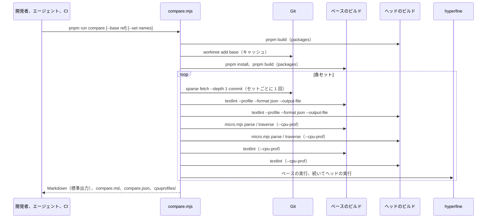

# 変更の比較の設計

[English](design.md)

## この文書について

この文書は [textlint](../../product.ja.md) の [変更の比較](requirements.ja.md) を設計します。1 つのスクリプトがベースとヘッドをビルドし、文書のセットを用意し、CLI、パーサー、トラバースを測り、CPU プロファイルを記録し、差を書く方法と、CI がプルリクエストのコードにシークレットも書き込み権限も与えずにそれを実行する方法を扱います。

### 読者

比較スクリプト、その CI ワークフロー、文書のセット、AI エージェント向けの指示を実装または変更する人とエージェント。

### 前提知識

- [パフォーマンスプロファイル](../performance-profile/requirements.ja.md)：`textlint --profile --format json` の JSON
- CLI の JSON フォーマッター（`--format json`）と `--output-file`
- Node.js の CPU プロファイル（`node --cpu-prof`）。Chrome DevTools で開ける
- GitHub Actions：`pull_request` イベント、`permissions`、ジョブサマリー（`GITHUB_STEP_SUMMARY`）、アーティファクト

### この文書の範囲外

- プロファイルのフェーズの意味。パフォーマンスプロファイルが扱う。
- `master` の実行時間の履歴を記録する `ci.yml` の `benchmark` ジョブ。変更しない。

## 実装の方針

成果物は次のとおりです。

- `test/benchmark/compare.mjs`：比較スクリプト。非公開のベンチマークパッケージの中にあり、small のセット（`examples/`）と Lint の設定（`.textlintrc.jtf-style.json`）の隣に置く。ルートの `package.json` は `"compare": "node test/benchmark/compare.mjs"` を持つ。
- `test/benchmark/micro.mjs`：1 つのビルドのプロセス内ベンチマーク。パーサーと、パース済みの木に対するカーネル。
- `test/benchmark/compare-sets.json`：small 以外のセット。それぞれリポジトリ、コミット、ラベル、リポジトリ内のパス、実行回数を持つ。
- `.github/workflows/profile-benchmark.yml`：CI ワークフロー。
- `.claude/skills/performance-check/SKILL.md` と `AGENTS.md` の 1 行：AI エージェント向けの指示。

どちらのスクリプトも Node.js の組み込みモジュールと、測るビルドのパッケージだけを使います。そのため新しいチェックアウトで動き、同じファイルでどのコミットも測れます。

`compare.mjs` の主な流れは次のとおりです。

1. **ビルド。** ヘッドは作業ツリーです。`--no-build` がなければ、スクリプトはそこで `pnpm --filter "./packages/**" run build` を実行します。Web サイトはビルドしません。ベースはコミットです。スクリプトは `--base`（デフォルトは `origin/master`、リモートのブランチがなければ `master`）を解決し、キャッシュディレクトリに `git worktree add` で detached なワークツリーを作ります。そこで `pnpm install --frozen-lockfile` と同じビルドを実行し、マーカーを書きます。マーカーのある同じコミットのワークツリーは再利用します。
2. **セット。** small のセットはヘッドの `test/benchmark/examples` です。ほかのセットでは、スクリプトはキャッシュディレクトリにディレクトリを作り、`git init`、`git sparse-checkout set --no-cone /<path>/**`、`git fetch --depth 1 --filter=blob:none origin <commit>`、`git checkout FETCH_HEAD` を実行して、パスの文書だけをダウンロードし、マーカーを書きます。マーカーのあるディレクトリは再利用します。`--set` はカンマ区切りでセットを選び、デフォルトはすべてのセットです。
3. **1 回の Lint。** 各ビルドについて、スクリプトはセットのディレクトリでビルドの CLI を 1 回実行します。
   `node <build>/packages/textlint/bin/textlint.js --config <head>/test/benchmark/.textlintrc.jtf-style.json --rules-base-directory <build>/test/benchmark/node_modules <set> --format json --output-file <tmp>/results.json --profile`
   標準出力がプロファイル、ファイルが Lint 結果なので、1 回の実行で両方が得られます。ビルドの `--help` が `--profile` を挙げないときは、このオプションを省き、そのビルドのプロファイルは `null` です。両方のビルドがヘッドの設定と、それぞれがインストールしたルールを使います。
4. **プロセス内ベンチマーク。** `parse`、続いて `traverse` について、スクリプトは `node --cpu-prof --expose-gc micro.mjs --build <build> --dir <set> --mode <mode>` をベース、ヘッドの順に実行します。比較の途中でマシンの状態が変わっても、両方に影響するようにするためです。CPU プロファイルは残します。
5. **CLI の CPU プロファイル。** スクリプトは各ビルドの CLI を `node --cpu-prof` でもう 1 回、`--profile` なしで実行します。
6. **CLI の実行時間。** `hyperfine` が `PATH` にあれば、スクリプトは手順 3 の 2 つのコマンドから `--profile` を除き `--output-file /dev/null` にしたもので、`hyperfine --ignore-failure --warmup 1 --runs <n> --export-json <tmp>/time.json` を実行します。ベースのすべての実行のあとにヘッドのすべての実行が続きます。ルールがエラーを報告すると終了ステータスが 1 になるので `--ignore-failure` が必要です。各引数はシェル向けにクォートします。hyperfine 1.x と 2.x の JSON を読めます。
7. **差。** スクリプトは結果を比べ（データモデルを参照）、Markdown を標準出力と `compare.md` に、`compare.json` と `cpuprofiles/` を出力ディレクトリに書きます。

`micro.mjs` はセットの Markdown ファイルを決まった順で読みます。`parse` モードでは、すべてをビルドの `@textlint/markdown-to-ast` で、続いて `@textlint/text-to-ast` でパースします。`traverse` モードでは、すべてを一度パースし、ビルドのカーネルで、`preProcess` がパース済みの木を返すプラグインと、`ASTNodeTypes` と、パース済みの木にある `yaml` などのすべてのノードの種類（exit の種類を含む）を空の関数で購読するルールを使って、それぞれを Lint します。そのため時間は、パースを除いた、トラバース、振り分け、ファイルごとのカーネルの処理です。各測定は 1 回のウォームアップのあと `runs × 2` 回実行し、各実行の前に `gc()` を呼びます。1 回の実行は、ウォームアップから求めた回数だけ処理を繰り返して 200 ms 以上かけ、その時間を回数で割ります。小さなセットを数ミリ秒で測らないためです。マシンのノイズは実行を遅くするだけなので、スクリプトはもっとも速い実行を比べます。

ビルドの失敗、セットのダウンロードの失敗、終了ステータスが 0 と 1 以外の Lint の実行は、ビルドかセットを示すメッセージとともに、終了ステータス 2 でスクリプトを止めます。そのときスクリプトは出力を書きません。

## アーキテクチャとシーケンス図



CI では、各セットがマトリクスの 1 つのジョブです。各ジョブが両方のビルドを作ります。ジョブ間でビルドを共有すると、パッケージとその `node_modules` をアーティファクトとしてアップロードすることになり、すべてのジョブが 1 つのビルドジョブを待つためです。

## データモデルと ER 図

JSON の出力（`compare.json`）：

```ts
type CompareResult = {
    base: { ref: string; commit: string };
    head: { commit: string; dirty: boolean };
    sets: SetResult[];
};
type SetResult = {
    name: "small" | "medium" | "large" | "huge";
    repository: string | null; // small では null
    commit: string | null;
    label: string | null;
    files: number; // セットの Markdown ファイル数
    messages: { base: number; head: number; added: Message[]; removed: Message[] };
    time: Compared<CliStats> | null; // hyperfine がないとき null
    parsers: ({ id: string } & Compared<MicroStats>)[]; // "@textlint/markdown-to-ast"、"@textlint/text-to-ast"
    traverse: Compared<MicroStats>;
    profiles: { base: TextlintProfileReport | null; head: TextlintProfileReport | null };
    cpu: Record<"base" | "head", Record<"cli" | "parse" | "traverse", CpuSummary>>;
};
type Message = { file: string; line: number; column: number; ruleId: string; message: string }; // file はセットからの相対パス
type Compared<S> = { base: S; head: S; ratio: number; mark: "slower" | "faster" | null };
type CliStats = { median: number; mean: number; stddev: number; runs: number }; // ミリ秒
type MicroStats = { median: number; min: number; max: number; runs: number; repeat: number }; // 1 回の繰り返しのミリ秒
type CpuSummary = {
    total: number; // サンプルのミリ秒
    packages: { name: string; workspace: boolean; time: number }[];
    functions: { name: string; package: string; location: string; time: number }[]; // self time の上位 50
};
```

メッセージは、ファイル、行、列、ルール ID、メッセージの多重集合として比べます。

`ratio` はヘッドをベースで割ったものです。CLI では中央値、パーサーとトラバースでは最小値を使います。`mark` は、CLI では `ratio >= 1.3` で `slower`、`ratio <= 0.77` で `faster`、パーサーとトラバースでは `1.1` と `0.91` で、それ以外は `null` です。両方の時間が 1 ms 未満の比較には印を付けません。

CPU プロファイルは self time でまとめます。サンプルは、ファイルが `<build>/packages/` の下にあればこのリポジトリのパッケージ（`workspace: true`）、最後の `node_modules/` のあとのパスで依存のパッケージ、`node:` のモジュールなら `(node)`、URL がなければ `(garbage collector)`、`(program)`、`(idle)`、`(native)` に属します。

Markdown の出力は、見出し「Profile and benchmark: base vs head」と、ベースとヘッドのリンク付きのコミットから始まります。セットが複数あれば、各セットの判定、CLI の比、メッセージ数の行を持つ表が続きます。次にしきい値を説明する行があります。そして各セットについて、次の順で持ちます。

1. セット、リンク付きのコミットとラベル、ファイル数の見出し。
2. 何が変わったかを示す 1 行。CLI の比を伴う `✅ No change in lint results`、または変わったもの（Lint 結果、印の付いたパーサー、traverse、CLI）を並べた `⚠️ Changed:`。
3. ベース、ヘッド、変化の表。CLI の実行時間、各パーサー、トラバース、メッセージ数。
4. 異なるときだけ：削除されたメッセージと追加されたメッセージ。それぞれ最大 50 行。
5. 折りたたんだセクション：ベースとヘッドのプロファイルを並べたもの（フェーズ、上位 10 ルール、遅いファイル）と、CLI、パーサー、トラバースそれぞれの、self time の上位 15 パッケージ（ベース、ヘッド、比）とヘッドの上位 15 関数。

CPU プロファイルは `cpuprofiles/<set>-<base|head>-<cli|parse|traverse>.cpuprofile` です。

## API とインターフェース

### コマンド

```
pnpm run compare [--base <ref>] [--set small,medium,large,huge] [--runs <n>] [--out-dir <dir>] [--cache-dir <dir>] [--no-build]
pnpm run compare --render <compare.json> [--render <compare.json>]...
```

- `--base`：Git の ref かコミット。デフォルトは `origin/master`、なければ `master`。
- `--set`：セット。デフォルトはすべて。
- `--runs`：すべてのセットでの CLI の実行回数。プロセス内ベンチマークはその 2 倍実行する。
- `--out-dir`：`compare.md`、`compare.json`、`cpuprofiles/` を書く場所。デフォルトはカレントディレクトリの `compare-result` で、`.gitignore` に含まれる。
- `--cache-dir`：ベースのワークツリーとセットを置く場所。デフォルトは `$XDG_CACHE_HOME/textlint-compare`、または `~/.cache/textlint-compare`。リポジトリの外なので、ビルド、リポジトリの Lint、pnpm のワークスペースからは見えない。
- `--no-build`：ヘッドをビルドしない（ビルド済み）。
- `--render`：以前の JSON の出力を 1 つの比較として Markdown で出力し、ビルドも Lint もしない。出力は同じベースとヘッドのコミットを持たなければならない。

終了ステータス：差にかかわらず比較を書けたら 0、実行できなければ 2。

### CI ワークフロー

`.github/workflows/profile-benchmark.yml`：

- `on: pull_request` と `paths`：`packages/**`、`test/benchmark/**`、`package.json`、`pnpm-lock.yaml`、`pnpm-workspace.yaml`、ワークフローのファイル、`!**/*.md`、続いて `test/benchmark/examples/**`。小さなセットの Markdown ファイルの変更でもワークフローを実行するためです（後のフィルターが優先されます）。
- ワークフローの `permissions: contents: read`。どのステップも `secrets` を使わない。
- ジョブ `compare` は `strategy.matrix.set: [small, medium, large, huge]` と `fail-fast: false` を持ち、`ubuntu-latest`、`timeout-minutes: 30` で動く。各ジョブの名前はセット。
- ステップ：`persist-credentials: false` と `fetch-depth: 0`（ベースのコミットが必要）でのチェックアウト、pnpm、`.node-version` の Node.js、`sudo apt-get install -y hyperfine`、`pnpm install --frozen-lockfile`、`--base "$BASE_SHA" --set "$SET" --out-dir "compare-result-$SET"` でのスクリプト、そして出力ディレクトリをアーティファクト `profile-benchmark-<set>` としてアップロード。
- ジョブ `summary` は、セットのジョブのどれかが失敗しても、それらのあとに実行される。アーティファクトをダウンロードし、すべての `compare.json` での `--render` の Markdown を `$GITHUB_STEP_SUMMARY` に追記する。結果のないセットがあればそう示す。
- ベースのコミットは `github.event.pull_request.base.sha` から、セットはマトリクスから、環境変数を通して渡す。
- アクションはコミット SHA で固定し、バージョンをコメントに書く。

### AI エージェント向けの指示

`AGENTS.md` は、クイックリファレンスに `textlint --profile`、`pnpm run compare`、スキルを示す 1 行を持ちます。スキル `.claude/skills/performance-check/SKILL.md` は、使う場面（パーサー、カーネル、トラバース、CLI、それらの依存の変更）、1 回の実行のプロファイルの取り方、素早い確認と最終確認に使うセット、出力の読み方（まず Lint 結果、次にパーサーとトラバース、次に CLI、最後に CPU プロファイル）、報告の仕方（Markdown を貼り、しきい値の範囲の変化を改善と呼ばない）を伝えます。

## 外部サービスとの連携

- **GitHub Actions**：ワークフローを実行し、リポジトリの保持期間の間アーティファクトを残す。デフォルトの読み取り専用の `GITHUB_TOKEN` 以外のトークンは使わず、スクリプトもそれを使わない。
- **GitHub（HTTPS の git）**：セットは、部分的、sparse、shallow な fetch でコミットを指定して取得する。GitHub は公開リポジトリのコミットに対してこれを許す。fetch の失敗は終了ステータス 2 でスクリプトを止める。
- **hyperfine**：CI では apt でインストールする。ローカルでは任意。

## データの扱い

セットは固定のコミットの公開リポジトリです。

| セット | リポジトリ | コミット | パス | ファイル数 |
| --- | --- | --- | --- | --- |
| small | このリポジトリ | （ヘッド） | `test/benchmark/examples` | 5 |
| medium | https://github.com/asciidwango/js-primer | `6c1a17c246baaf0f6ae573a6947acddef6f6b5f9`（v7.0.0） | `source` | 88 |
| large | https://github.com/mdn/translated-content | `9c47047bc8d72a1a900f6f807edbcca072618ae1` | `files/ja/web/javascript` | 1,037 |
| huge | https://github.com/mdn/translated-content | `9c47047bc8d72a1a900f6f807edbcca072618ae1` | `files/ja` | 10,362 |

コミットはそれだけを変えるプルリクエストでのみ変えます。プルリクエストの比較で、セットの変化とコードの変化が混ざらないようにするためです。
キャッシュディレクトリは利用者が消すまで残ります。スクリプトは、キャッシュの項目（ベースのビルドやセット）をロックディレクトリ `<entry>.lock` を持っている間に用意し、ロックを得たあとにマーカーを再び確かめます。ロックがあれば、比較はほかの比較が動いていなければそれを消すよう利用者に伝えるエラーで終わります。スクリプトは自分が作っていないロックを消しません。実行の一時ファイル（Lint 結果と時間）は、スクリプトの終了時に消します。

## 認証と認可の注意

CI ジョブは読み取り専用の `GITHUB_TOKEN` を持ち、シークレットは持ちません。`actions/checkout` はトークンを Git の設定に残さない（`persist-credentials: false`）ので、プルリクエストのコードはそれで push できません。

## セキュリティの考慮事項

ワークフローはプルリクエスト（フォークからのものを含む）のコードを実行するので、`pull_request_target` ではなく `pull_request` を使います。GitHub は `pull_request` では、フォークからのプルリクエストにシークレットを与えず、読み取り専用のトークンを与えます。書き込み権限を持つものは比較の出力を読みません。後でプルリクエストにコメントするワークフローを作るなら、`workflow_run` を使い、プルリクエストのコードをチェックアウトも実行もせず、アーティファクトを信頼できないデータとして扱わなければなりません。

ベースのコミットとセットはイベントとマトリクスから来て、環境変数で渡すので、ブランチ名やプルリクエストのタイトルがシェルのコマンドの一部になることはありません。Markdown は、ファイルパス、ルール ID、メッセージの `|`、`\`、バッククォートをエスケープし、制御文字を取り除きます。

## デプロイの注意

なし。マージ後、パッケージを変更する最初のプルリクエストからワークフローが動きます。それより前に開いたプルリクエストは、自身のヘッドのワークフローを実行します。

## 検討した代替案

### CLI の実行時間だけ

共有のマシンでは CLI の実行時間は実行ごとに 10% 以上変わり、その大半をルールが使うので、パーサーやカーネルの変化が隠れます。プロセス内ベンチマークは、CLI のほかの部分を除いてそれらを測ります。

### Lint からパースを引いてトラバースとする

パース込みで Lint し、別に測ったパースの時間を引くと、ノイズのある 2 つの数値の差になります。カーネルにパース済みの木を渡すと、トラバースを直接測れます。

### `preset-ja-technical-writing` のルール

多くの日本語のプロジェクトが使うルールですが、形態素解析が実行の大半を使うので、textlint の処理は小さな部分になります。`preset-jtf-style` は正規表現でチェックするので textlint の処理が見えやすく、どちらのプリセットも `benchmark` ジョブのためにインストール済みです。

### 1 回ビルドしてジョブ間でビルドを共有する

各ジョブのビルドを省けますが、アーティファクトがパッケージとその `node_modules` を持つことになり、ジョブが 1 つのビルドジョブを待ちます。ジョブは並行して動くので選びませんでした。

### CI でセットをキャッシュする

`actions/cache` でセットを残せますが、sparse な fetch は数秒で終わり、プルリクエストと共有するキャッシュはセットのファイルを変えられる場所を増やします。選びませんでした。

### ベンチマークのサービス

命令数を数える方式はノイズが小さいですが、外部サービスが増えます。今は選びません。プロセス内ベンチマークと CPU プロファイルで、サービスなしの比較ができます。

## 未解決事項

- **しきい値：** Requirements を参照。設計は `compare.mjs` の先頭の定数からそれを読む。
