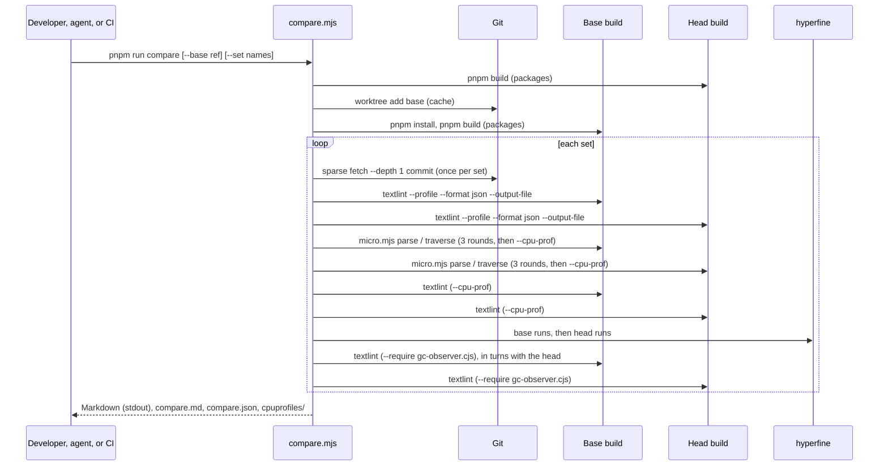

# Change comparison design

[日本語](design.ja.md)

## About this document

This document designs [Change comparison](requirements.md) of [textlint](../../product.md): how one script builds the base and the head, prepares the sets of documents, measures the CLI, the parsers, and the traversal, records CPU profiles, and writes the differences, and how CI runs it for a pull request without giving the code of the pull request any secret or write access.

### Audience

People and agents who implement or change the comparison script, its CI workflow, the sets of documents, or the instruction for AI agents.

### Prerequisites

- [Performance profile](../performance-profile/requirements.md): the JSON of `textlint --profile --format json`
- The JSON formatter of the CLI (`--format json`) and `--output-file`
- The CPU profile of Node.js (`node --cpu-prof`), which Chrome DevTools opens
- GitHub Actions: the `pull_request` event, `permissions`, the job summary (`GITHUB_STEP_SUMMARY`), and artifacts

### Outside this document

- The meaning of the phases of the profile. They belong to Performance profile.
- The `benchmark` job of `ci.yml`, which records a history of run times on `master`. It is not changed.

## Implementation approach

The deliverables are:

- `test/benchmark/compare.mjs`: the comparison script. It is in the private benchmark package, next to the small set (`examples/`) and the configuration of the lint (`.textlintrc.jtf-style.json`). The root `package.json` has `"compare": "node test/benchmark/compare.mjs"`.
- `test/benchmark/micro.mjs`: the in-process benchmark of one build: the parsers, and the kernel on parsed trees.
- `test/benchmark/gc-observer.cjs`: a script that a run of the CLI loads to record its garbage collections.
- `test/benchmark/compare-sets.json`: the sets other than small, each with its repository, commit, label, path in the repository, and number of runs.
- `.github/workflows/profile-benchmark.yml`: the CI workflow.
- `.claude/skills/performance-check/SKILL.md` and a line in `AGENTS.md`: the instruction for AI agents.

The scripts use only the built-in modules of Node.js and the packages of the build that they measure, so they run on a fresh checkout and the same file measures any commit.

The main flow of `compare.mjs` is:

1. **Builds.** The head is the working tree. The script runs `pnpm --filter "./packages/**" run build` in it unless `--no-build` is given; the website is not built. The base is a commit: the script resolves `--base` (default `origin/master`, or `master` when there is no remote branch) and creates a detached worktree of it in the cache directory with `git worktree add`. It runs `pnpm install --frozen-lockfile` and the same build there, and writes a marker. A worktree of the same commit with the marker is reused.
2. **Sets.** The small set is `test/benchmark/examples` of the head. For another set, the script creates a directory in the cache directory, runs `git init`, `git sparse-checkout set --no-cone /<path>/**`, `git fetch --depth 1 --filter=blob:none origin <commit>`, and `git checkout FETCH_HEAD`, so only the documents of the path are downloaded, and writes a marker. A directory with the marker is reused. `--set` selects the sets, separated by commas; the default is all sets.
3. **Lint once.** For each build, the script runs the CLI of the build once in the directory of the set:
   `node <build>/packages/textlint/bin/textlint.js --config <head>/test/benchmark/.textlintrc.jtf-style.json --rules-base-directory <build>/test/benchmark/node_modules <set> --format json --output-file <tmp>/results.json --profile`.
   The standard output is the profile and the file has the lint results, so one run gives both. When `--help` of the build does not list `--profile`, the option is left out and the profile of that build is `null`. Both builds use the configuration of the head and their own installed rules.
4. **In-process benchmarks.** For `parse` and then `traverse`, the script runs `node --expose-gc micro.mjs --build <build> --dir <set> --mode <mode>` in 3 rounds, the base and then the head in each round, each in a new process, so a change of the machine during the comparison affects both. The runs are split among the rounds. The fastest run of all rounds is compared, and the median is the median of the medians of the rounds. These processes do not record a CPU profile, because the sampling adds noise; one more process with `--cpu-prof` and one run records it for each build.
5. **CPU profile of the CLI.** The script runs the CLI of each build once more with `node --cpu-prof`, without `--profile`.
6. **Run time of the CLI.** When `hyperfine` is on `PATH`, the script runs `hyperfine --ignore-failure --warmup 1 --runs <n> --export-json <tmp>/time.json` with the two commands of step 3 without `--profile` and with `--output-file /dev/null`: first all runs of the base, then all runs of the head. `--ignore-failure` is needed because the exit status is 1 when a rule reports an error. Each argument is quoted for the shell. The JSON of hyperfine 1.x and 2.x is read.
7. **Garbage collection.** The script runs the command of step 6 with `node --require <head>/test/benchmark/gc-observer.cjs` and the environment variable `GC_OBSERVER_OUTPUT=<tmp>/gc.json`, as many times as the runs of the CLI for each build, the base and then the head in turns, so a change of the machine affects both. `gc-observer.cjs` is the file of the head for both builds. It observes the `gc` entries of `PerformanceObserver` (`node:perf_hooks`), and before the process exits, it waits a few turns of the event loop, because Node.js passes an entry to the observer in a later turn and the collections of the last work of the CLI would be lost. Then it takes the entries that the observer has not got yet and writes the number and the total duration of the minor collections (scavenge, minor mark-sweep) and of the major collections (the other kinds) to the file. The duration of an entry is the time that the collection stops the main thread. The runs are separate from step 6, so the observer does not change the run time that is compared. The run with the median total stands for a build.
8. **Differences.** The script compares the results (see Data model), and writes Markdown to the standard output and `compare.md`, `compare.json`, and `cpuprofiles/` to the output directory.

`micro.mjs` reads the Markdown files of the set in a fixed order. In `parse` mode, it parses all of them with `@textlint/markdown-to-ast` and then with `@textlint/text-to-ast` of the build. In `traverse` mode, it parses all of them once, and lints each with the kernel of the build, a plugin whose `preProcess` returns the parsed tree, and a rule that listens to every node type of `ASTNodeTypes` and every node type in the parsed trees, such as `yaml` (including the exit types) with an empty function; so the time is the traversal, the dispatch, and the work of the kernel for a file, without parsing. Each measurement runs once to warm up and then `runs × 2` times, calling `gc()` before each run. A run repeats the work until it takes at least 200 ms, as many times as the warm-up says, and its time is divided by that number, so a small set is not measured by a few milliseconds. The script compares the fastest run, because the noise of a machine only makes a run slower.

A build failure, a failure to download a set, or a lint run that ends with an exit status other than 0 and 1 stops the script with the exit status 2 and a message that names the build or the set. The script writes no output then.

## Architecture and sequence diagrams



In CI, each set is one job of a matrix. Each job builds both builds, because sharing a build between jobs would mean uploading the packages and their `node_modules` as an artifact, and every job would wait for one build job.

## Data model and ER diagrams

The JSON output (`compare.json`):

```ts
type CompareResult = {
    base: { ref: string; commit: string };
    head: { commit: string; dirty: boolean };
    sets: SetResult[];
};
type SetResult = {
    name: "small" | "medium" | "large" | "huge";
    repository: string | null; // null for small
    commit: string | null;
    label: string | null;
    files: number; // Markdown files of the set
    messages: { base: number; head: number; added: Message[]; removed: Message[] };
    time: Compared<CliStats> | null; // null when hyperfine is not installed
    gc: Compared<GcStats>; // the garbage collections of a run of the CLI
    parsers: ({ id: string } & Compared<MicroStats>)[]; // "@textlint/markdown-to-ast", "@textlint/text-to-ast"
    traverse: Compared<MicroStats>;
    profiles: { base: TextlintProfileReport | null; head: TextlintProfileReport | null };
    cpu: Record<"base" | "head", Record<"cli" | "parse" | "traverse", CpuSummary>>;
};
type Message = { file: string; line: number; column: number; ruleId: string; message: string }; // file is relative to the set
type Compared<S> = { base: S; head: S; ratio: number; mark: "slower" | "faster" | null };
type CliStats = { median: number; mean: number; stddev: number; runs: number }; // milliseconds
type MicroStats = { median: number; min: number; max: number; runs: number; repeat: number }; // milliseconds of one repetition
type GcStats = {
    median: number; // milliseconds of pause of a run: the median, the minimum, and the maximum of the runs
    min: number;
    max: number;
    runs: number;
    minor: { count: number; time: number }; // of the run with the median pause
    major: { count: number; time: number };
};
type CpuSummary = {
    total: number; // milliseconds of samples
    packages: { name: string; workspace: boolean; time: number }[];
    functions: { name: string; package: string; location: string; time: number }[]; // top 50 by self time
};
```

Messages are compared as multisets of the file, the line, the column, the rule id, and the message.

`ratio` is the head divided by the base: the median for the CLI and the pause of garbage collection, and the minimum for the parsers and the traversal. `mark` is `slower` when `ratio >= 1.3` and `faster` when `ratio <= 0.77` for the CLI, and `1.1` and `0.91` for the parsers and the traversal; otherwise `null`. A comparison where both times are below 1 ms is not marked. For the pause of garbage collection, the ratios are `1.3` and `0.77`, a comparison where both pauses are below 10 ms is not marked, and the Markdown calls the marks longer and shorter.

A CPU profile is summarized by self time. A sample belongs to a package of this repository when its file is under `<build>/packages/` (`workspace: true`), to a dependency by the path after the last `node_modules/`, to `(node)` for `node:` modules, and to `(garbage collector)`, `(program)`, `(idle)`, or `(native)` when it has no URL.

The Markdown output starts with the heading "Profile and benchmark: base vs head" and the linked commits of the base and the head; the ref of the base follows its link unless it is the commit itself. The titles of the collapsed sections use HTML (`<code>`), because GitHub does not parse Markdown in `<summary>`. With more than one set, a table follows with one row for each set: the verdict, the CLI ratio, and the number of messages. Then a line explains the thresholds. Then it has, for each set, in this order:

1. A heading with the set, the linked commit and label, and the number of files.
2. One line that says what changed: `✅ No change in lint results` with the CLI ratio, `⚠️ Changed:` with the list of what changed (lint results, a marked parser, traverse, the CLI, or the pause of garbage collection), or `✅ Improved:` with the same list when the lint results are the same and every mark is faster or shorter, so the warning sign is only on a change to look at.
3. A table of the base, the head, and the change: the CLI run time, the pause of garbage collection with the numbers of minor and major collections, each parser, the traversal, and the number of messages. A result of a version of the script that did not measure the garbage collection is rendered without that row.
4. Only when they differ: the removed and the added messages, at most 50 rows each.
5. Collapsed sections: the profile of the base and the head side by side (phases, top 10 rules, slowest files; when the base has no `--profile`, the head only, without empty base columns), and for the CLI, the parsers, and the traversal the top 15 packages by self time with the base, the head, and the ratio, and the top 15 functions of the head.

The CPU profiles are `cpuprofiles/<set>-<base|head>-<cli|parse|traverse>.cpuprofile`.

## APIs and interfaces

### Command

```
pnpm run compare [--base <ref>] [--set small,medium,large,huge] [--runs <n>] [--out-dir <dir>] [--cache-dir <dir>] [--no-build]
pnpm run compare --render <compare.json> [--render <compare.json>]...
```

- `--base`: a Git ref or commit. Default: `origin/master`, else `master`.
- `--set`: the sets. Default: all.
- `--runs`: the runs of the CLI for every set; the in-process benchmarks run twice as many.
- `--out-dir`: where `compare.md`, `compare.json`, and `cpuprofiles/` are written. Default: `compare-result` in the current directory, which `.gitignore` lists.
- `--cache-dir`: where the base worktrees and the sets are kept. Default: `$XDG_CACHE_HOME/textlint-compare`, or `~/.cache/textlint-compare`. It is outside the repository, so the build, the lint of the repository, and the pnpm workspace do not see it.
- `--no-build`: do not build the head (it is already built).
- `--render`: print the Markdown of earlier JSON outputs as one comparison, and build or lint nothing. The outputs must have the same base and head commits.

Exit status: 0 when the comparison is written, whatever the differences are; 2 when it can not run.

### CI workflow

`.github/workflows/profile-benchmark.yml`:

- `on: pull_request` with `paths`: `packages/**`, `test/benchmark/**`, `package.json`, `pnpm-lock.yaml`, `pnpm-workspace.yaml`, the workflow file, `!**/*.md`, and then `test/benchmark/examples/**`, so a change of the Markdown files of the small set runs the workflow (a later filter wins).
- `permissions: contents: read` for the workflow. No step uses `secrets`.
- The job `compare` with `strategy.matrix.set: [small, medium, large, huge]` and `fail-fast: false`, on `ubuntu-latest`, `timeout-minutes: 30`. The name of each job is the set.
- Steps: checkout with `persist-credentials: false` and `fetch-depth: 0` (the base commit is needed); pnpm; Node.js from `.node-version`; `sudo apt-get install -y hyperfine`; `pnpm install --frozen-lockfile`; the script with `--base "$BASE_SHA" --set "$SET" --out-dir "compare-result-$SET"`; then the output directory uploaded as the artifact `profile-benchmark-<set>`.
- The job `summary` runs after the jobs of the sets, also when one of them failed. It downloads the artifacts and appends the Markdown of `--render` with all `compare.json` to `$GITHUB_STEP_SUMMARY`. It says so when a set has no result.
- The base commit comes from `github.event.pull_request.base.sha` and the set from the matrix, through environment variables.
- Actions are pinned by commit SHA with the version in a comment.

### Instruction for AI agents

`AGENTS.md` has one line in the quick reference that names `textlint --profile`, `pnpm run compare`, and the skill. The skill `.claude/skills/performance-check/SKILL.md` says when to use it (a change to a parser, the kernel, traversal, the CLI, or their dependencies), how to profile one run, which sets to use for a quick and a final check, how to read the output (lint results first, then the parsers and the traversal, then the CLI and its pause of garbage collection, then the CPU profiles), and how to report (paste the Markdown, and do not call a change within the thresholds an improvement).

## External service integration

- **GitHub Actions**: runs the workflow and keeps the artifacts for the retention period of the repository. No token other than the default read-only `GITHUB_TOKEN` is used, and the script does not use it.
- **GitHub (git over HTTPS)**: the sets are fetched by commit with a partial, sparse, shallow fetch, which GitHub allows for a commit of a public repository. A fetch failure stops the script with the exit status 2.
- **hyperfine**: installed with apt in CI. Optional locally.

## Data handling

The sets are public repositories at fixed commits:

| Set | Repository | Commit | Path | Files |
| --- | --- | --- | --- | --- |
| small | this repository | (the head) | `test/benchmark/examples` | 5 |
| medium | https://github.com/asciidwango/js-primer | `6c1a17c246baaf0f6ae573a6947acddef6f6b5f9` (v7.0.0) | `source` | 88 |
| large | https://github.com/mdn/translated-content | `9c47047bc8d72a1a900f6f807edbcca072618ae1` | `files/ja/web/javascript` | 1,037 |
| huge | https://github.com/mdn/translated-content | `9c47047bc8d72a1a900f6f807edbcca072618ae1` | `files/ja` | 10,362 |

A commit is changed only in a pull request of its own, so the comparison of a pull request never mixes a change of a set with a change of the code.
The cache directory is kept until the user deletes it. The script prepares an entry of the cache (a base build or a set) while it holds a lock directory `<entry>.lock`, and checks the marker again after it gets the lock. When the lock exists, the comparison ends with an error that tells the user to remove it if no other comparison runs; the script never removes a lock that it did not make. The temporary files of a run (lint results and times) are deleted when the script ends.

## Authentication and authorization notes

The CI job has the read-only `GITHUB_TOKEN` and no secret. `actions/checkout` does not keep the token in the Git configuration (`persist-credentials: false`), so the code of the pull request can not use it to push.

## Security considerations

The workflow runs the code of the pull request, including a pull request from a fork, so it uses `pull_request` and not `pull_request_target`: GitHub gives a pull request from a fork no secret and a read-only token on `pull_request`. Nothing that has write access reads the output of the comparison. A later workflow that comments on the pull request must use `workflow_run`, must not check out or run the code of the pull request, and must treat the artifacts as untrusted data.

The base commit and the set come from the event and the matrix, and they are passed through environment variables, so a branch name or a title of a pull request is never part of a shell command. The Markdown escapes `|`, `\`, and backquotes and removes control characters in file paths, rule ids, and messages.

## Deployment notes

None. The workflow starts with the first pull request that changes a package after it is merged. A pull request opened before that runs the workflow of its own head.

## Alternatives considered

### Only the CLI run time

The run time of the CLI on a shared machine changes by more than 10% between runs, and the rules take most of it, so a change of a parser or the kernel is hidden. The in-process benchmarks measure them without the rest of the CLI.

### Garbage collection from the CPU profile or from `--trace-gc`

The CPU profile of the CLI has the samples of `(garbage collector)`, but it comes from one run, and the sampling adds its own load. `--trace-gc` prints every collection, but as text for people whose format V8 can change. `PerformanceObserver` is a documented API of Node.js, and gives the same durations as numbers.

### Failing a check on a longer pause of garbage collection

A lint rule can not find the code that makes objects live longer, because it depends on how V8 allocates and not on the syntax alone, and a threshold that fails CI would fail on noise. The comparison marks the change, as it does for the times, and a person decides.

### Traversal as the lint minus the parse

Linting with parsing and subtracting a separate parse time gives the difference of two noisy numbers. Giving the kernel parsed trees measures the traversal directly.

### The rules of `preset-ja-technical-writing`

They are the rules that many Japanese projects use, but the morphological analysis takes most of a run, so the work of textlint is a small part. `preset-jtf-style` checks with regular expressions and keeps the work of textlint visible, and both presets are already installed for the `benchmark` job.

### Building once and sharing the builds between the jobs

It saves the build in each job, but the artifact would have the packages and their `node_modules`, and the jobs would wait for one build job. Not chosen, because the jobs run in parallel.

### Caching the sets in CI

`actions/cache` could keep the sets, but the sparse fetch takes seconds, and a cache shared with pull requests adds a place where the files of a set could be changed. Not chosen.

### A benchmarking service

Instruction counting has little noise, but it adds an external service. Not chosen for now; the in-process benchmarks and the CPU profiles give a comparison without a service.

## Open questions

- **Thresholds:** see the Requirements. The design reads them from constants at the top of `compare.mjs`.
