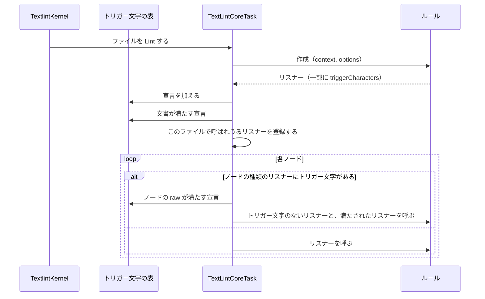

# リスナーのトリガー文字の設計

[English](design.md)

## この文書について

この文書は、[textlint](../../product.ja.md) の [リスナーのトリガー文字](requirements.ja.md) を設計します。ルールがリスナーにトリガー文字を付ける方法、カーネルがノードのテキストを 1 回読むだけで呼ぶべきリスナーを見つける方法、`textlint-tester` が宣言を確かめる方法を扱います。

### 読者

カーネルまたは `textlint-tester` を変更する人とエージェント、およびトリガー文字を追加するルールの作者。

### 前提知識

- カーネルでの Lint の流れ：ファイルごとに、`TextLintCoreTask` が各ルールの作成関数を呼び、返されたリスナーをノードの種類ごとに登録し、木をトラバースして、各ノードの種類のリスナーを呼ぶ
- [TxtAST](../txtast/requirements.ja.md)：ノードの `raw` は、文書のうちノードが覆う部分である

### この文書の範囲外

- リスナーにトリガー文字を付ける、ルールの作者向けのヘルパー。このリポジトリの外にある、ルール用のヘルパーパッケージが扱う。
- 公開されている各ルールのトリガー文字。

## 実装の方針

ルールはトリガー文字をリスナー関数のプロパティとして宣言し、カーネルはすべての宣言を 1 つの表にまとめます。ノードのテキストを 1 回たどるだけで、呼ぶべきすべてのリスナーが分かるようにするためです。
方針は、宣言、表、カーネルが表を使う 2 つの場所の 3 つからなります。

### 宣言

トリガー文字は、リスナー関数の `triggerCharacters` プロパティで、文字列です。

```js
module.exports = function (context) {
    const { Syntax } = context;
    const checkParentheses = (node) => {
        // ノードの "(" と ")" を探して報告する
    };
    checkParentheses.triggerCharacters = "()（）";
    return {
        [Syntax.Str]: checkParentheses
    };
};
```

関数のプロパティを選んだのは、この機能のない textlint が無視するからです。作成関数が返すオブジェクトは、これまでどおりノードの種類から関数への対応なので、ルールはそこではトリガー文字のないルールとして動きます。
宣言は作成関数の中で行うので、ルールのオプションに応じて変えられ、リスナーごとに持てます。
`@textlint/types` のリスナーの型に、省略できるプロパティを加えます。

### トリガー文字の表

カーネルは、文字から、その文字を持つ宣言の集合への表を持ちます。
宣言とは、トリガー文字の文字列 1 種類のことです。同じ文字列を持つ複数のルールのリスナーは、1 つの項目を共有します。
集合はビットの集合です。そのため、テキストのすべての文字の集合の和は、文字ごとに数回のビット演算で求まり、テキストを 1 回たどれば、そのテキストが満たす宣言が分かります。

表は 1 つの `TextlintKernel` に属し、それと同じ間だけ存在します。そのため表を作るのは実行につき 1 回で、ファイルごとではありません。モジュールレベルの値ではなく、2 つのカーネルが共有することもありません。
表の大きさは、宣言の種類の数とその文字で決まり、ファイルやノードの数では決まりません。

基本多言語面の外の文字は、UTF-16 のコードユニット 2 つです。表は先頭のコードユニットを持ち、それで見つかった宣言は、コードポイントでテキストと照らして確かめます。そのため、リスナーが呼ばれるのはその文字があるときだけです。

### ファイルで表を使う

ファイルのトラバースの前に、カーネルは文書のテキストを 1 回たどり、文書が満たす宣言を求めます。
文書が満たさない宣言を持つリスナーは、そのファイルでは登録しません。すべてのノードのテキストは文書の一部なので、どのノードもその宣言を満たせないためです。
あるルールのトリガー文字を 1 つも持たないファイルでは、かかるのはルールの作成だけで、ノードごとには何もかかりません。

### ノードで表を使う

カーネルはノードに着くと、そのファイルで登録された、そのノードの種類のリスナーを見ます。
その中にトリガー文字を持つものがなければ、この機能がないときと同じようにリスナーを呼び、テキストを読みません。
あれば、ノードの `raw` を 1 回たどって、ノードが満たす宣言を求め、トリガー文字のないリスナーと、宣言が満たされたリスナーを、登録の順序で呼びます。

ノードについての結果は、その呼び出しにだけ使います。カーネルはそれをノードに保存しないので、ルールやプラグインからは見えません。
`--fix` では、修正の各回が新しいテキストで新しいタスクを実行するので、カーネルはその回のリスナーが見るテキストを見ます。

### 検証

カーネルはリスナーを登録するときに `triggerCharacters` を読みます。`undefined` はトリガー文字なし、1 文字以上の文字列は宣言で、それ以外は、ルールの ID とノードの種類を持つエラーを投げます。
カーネルは、プロファイルや `TIMING=1` のためにリスナーを包む前にプロパティを読みます。プロファイルが包むのは実際に呼ばれる関数だけなので、ルールの回数は実際に行われた呼び出しの数になります。

### `textlint-tester`

`textlint-tester` は、テストケースを 2 回 Lint して結果を比べることで、宣言の約束を確かめます。
テスト対象のルールの作成関数を包みます。包んだ関数は、リスナーに `triggerCharacters` があるかを記録し、2 回目の Lint では同じリスナーをプロパティなしで返します。そのため、すべてのリスナーがその種類のすべてのノードで呼ばれます。
2 回の Lint でメッセージまたは修正したテキストが違うとき、テストケースは、ルールの ID と両方の結果を示して失敗します。
リスナーに `triggerCharacters` がないルールは、この機能がないときと同じく 1 回だけ Lint します。

## アーキテクチャとシーケンス図



## データモデルと ER 図

```ts
// @textlint/types：リスナー関数はトリガー文字を持てる
type TextlintRuleListener<Node> = ((node: Node) => void | Promise<void>) & {
    triggerCharacters?: string;
};
```

ER 図は要りません。データは、文字から宣言の集合への、メモリ上の表だけです。

## API とインターフェース

### ルールとフィルタールール

- リスナー関数の `triggerCharacters`：1 文字以上の文字列。文字列の各コードポイントがトリガー文字です。

### `@textlint/kernel`

新しいオプションも新しいエクスポートもありません。Lint の結果の形は同じです。

### `textlint-tester`

新しいオプションはありません。トリガー文字を持つルールのテストケースは、トリガー文字の有無で結果が違うことを示す新しいメッセージで失敗することがあります。

## 外部サービスとの連携

なし。

## データの扱い

表は、カーネルがある間メモリにあります。ルールが宣言した文字を持ち、文書のテキストを持ちません。

## 認証と認可の注意

なし。

## セキュリティの考慮事項

[要件](requirements.ja.md) に書いたこと以外にはありません。宣言はルールのデータであり、誤った宣言のエラーは文書のテキストを持ちません。

## デプロイの注意

プロパティは追加です。ルールは、対応する textlint のバージョンを上げずにトリガー文字を追加でき、プリセットはルールごとに追加できます。
トリガー文字を追加するルールは、この確認を持つ `textlint-tester` でテストを実行するべきです。

## 検討した代替案

### リスナーを関数ではなくオブジェクトにする

`{ [Syntax.Str]: { triggerCharacters: "()", handler } }` は読みやすいものの、この機能のない textlint はオブジェクトを呼ぼうとして失敗します。ルールは、何かを宣言するために、それらのバージョンへの対応をやめなければなりません。

### ルールモジュールのフィールド

`{ linter, fixer, triggerCharacters }` も、この機能のない textlint は無視します。しかし、ルールのオプションが分かる前に決まり、説明する対象のリスナーから離れているので、複数のリスナーを持つルールには、ノードの種類ごとの対応がもう 1 つ必要です。強みは、カーネルがファイルでのルールの作成を省けることです。ただし作成は、呼び出しに比べて、ルールの時間の小さな部分です。

### リスナーごとの正規表現

正規表現は、文字の集合より多くのことを表せます。しかしカーネルは、各リスナーの正規表現を各ノードで実行することになります。それはルールがすでにしている処理なので、呼び出しが同じ数のテストに置き換わるだけです。文字の集合なら、すべてのリスナーが 1 回の走査を共有できます。

### リスナーのキーに条件を書く

`Str[raw*="("]` のようなキーは、ESLint のセレクターにならったものです。この機能のない textlint は、それを現れないノードの種類とみなし、リスナーを呼びません。ルールはエラーなしにメッセージを失います。

### context のメソッド

`context.onCharacters("()", Syntax.Str, listener)` はメソッドがあることを必要とします。ルールは、その有無を確かめ、リスナーを登録する方法をもう 1 つ持たなければなりません。

## 未解決事項

### 宣言の名前と形

未解決のこと：宣言を、ここで提案したリスナー関数の `triggerCharacters` プロパティにするか、代替案の別の形にするか。
当面の扱い：この設計の残りの部分は、カーネルがリスナーを登録するときに宣言を読めるかぎり、形に依存しません。
見直す条件：実装を始める前。
決める人：textlint のメンテナー。
