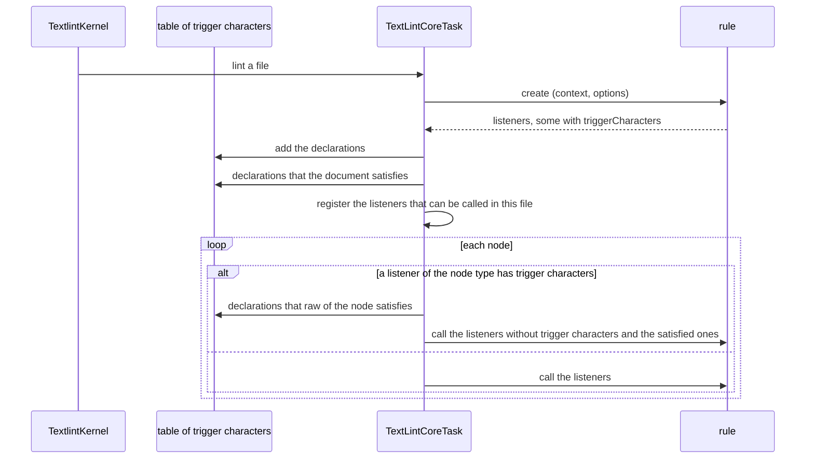

# Listener trigger characters design

[日本語](design.ja.md)

## About this document

This document designs [Listener trigger characters](requirements.md) of [textlint](../../product.md): how a rule attaches trigger characters to a listener, how the kernel finds the listeners to call for a node with one reading of its text, and how `textlint-tester` checks a declaration.

### Audience

People and agents who change the kernel or `textlint-tester`, and authors of rules who add trigger characters.

### Prerequisites

- The flow of a lint in the kernel: for each file, `TextLintCoreTask` calls the creator of each rule, registers the listeners that it returns by node type, traverses the tree, and calls the listeners of the type of each node
- [TxtAST](../txtast/requirements.md): `raw` of a node is the part of the document that the node covers

### Outside this document

- A helper for authors of rules that attaches trigger characters to a listener. It belongs to a helper package for rules, outside this repository.
- The trigger characters of each published rule.

## Implementation approach

A rule declares trigger characters as a property of the listener function, and the kernel turns all declarations into one table, so that one pass over the text of a node gives every listener to call.
The approach has three parts: the declaration, the table, and the two places where the kernel uses the table.

### The declaration

The trigger characters are the `triggerCharacters` property of a listener function, a string.

```js
module.exports = function (context) {
    const { Syntax } = context;
    const checkParentheses = (node) => {
        // look for "(" and ")" in the node and report
    };
    checkParentheses.triggerCharacters = "()（）";
    return {
        [Syntax.Str]: checkParentheses
    };
};
```

A property of the function is chosen because a textlint without this feature ignores it: the object that the creator returns still maps a node type to a function, so the rule runs there as a rule without trigger characters.
The declaration is made inside the creator, so it can depend on the options of the rule, and each listener has its own.
The type of a listener in `@textlint/types` gets the optional property.

### The table of trigger characters

The kernel keeps a table from a character to the set of declarations that have the character.
A declaration is a distinct string of trigger characters; listeners of several rules with the same string share one entry.
The set is a bit set, so the union of the sets of all characters of a text is a few bitwise operations for each character, and one pass over a text gives the declarations that the text satisfies.

The table belongs to one `TextlintKernel` and lives as long as it, so the table is built once for a run and not once for each file. It is not a module-level value, and two kernels do not share it.
Its size depends on the number of distinct declarations and their characters, not on the number of files or nodes.

A character outside the Basic Multilingual Plane is two UTF-16 code units. The table has its leading code unit, and a declaration found through it is confirmed against the text by its code point, so the listener is called only when the character is there.

### Using the table for a file

Before the traversal of a file, the kernel passes over the text of the document once and gets the declarations that the document satisfies.
A listener whose declaration the document does not satisfy is not registered for the file: the text of every node is a part of the document, so no node can satisfy it.
A file that has none of the trigger characters of a rule costs the creation of the rule and nothing for each node.

### Using the table for a node

When the kernel reaches a node, it looks at the listeners of the type of the node that are registered for the file.
If none of them has trigger characters, it calls them as it does without this feature and does not read the text.
Otherwise it passes over `raw` of the node once, gets the declarations that the node satisfies, and calls the listeners without trigger characters and the listeners whose declaration is satisfied, in the order of registration.

The result of a node is used for that call only. The kernel does not store it on the node, so a rule or a plugin never sees it.
With `--fix`, each pass of fixes runs a new task on the new text, so the kernel looks at the text that the listeners of that pass see.

### Validation

When the kernel registers a listener, it reads `triggerCharacters`. `undefined` means no trigger characters; a string of one or more characters is a declaration; anything else throws an error with the id of the rule and the node type.
The kernel reads the property before it wraps the listener for the profile or `TIMING=1`, and the profile wraps only the function that is called, so the count of a rule is the number of the calls that were made.

### `textlint-tester`

`textlint-tester` checks the promise of a declaration by linting a test case twice and comparing the results.
It wraps the creator of the rule under test. The wrapper notes whether a listener has `triggerCharacters`, and for the second lint it returns the same listeners without the property, so every listener is called for every node of its type.
When the messages or the fixed text of the two lints differ, the test case fails with the id of the rule and both results.
A rule whose listeners have no `triggerCharacters` is linted once, as without this feature.

## Architecture and sequence diagrams



## Data model and ER diagrams

```ts
// @textlint/types: a listener function can have trigger characters
type TextlintRuleListener<Node> = ((node: Node) => void | Promise<void>) & {
    triggerCharacters?: string;
};
```

No ER diagram is needed: the only data is the table in memory, from a character to a set of declarations.

## APIs and interfaces

### Rules and filter rules

- `triggerCharacters` of a listener function: a string of one or more characters. Each code point of the string is a trigger character.

### `@textlint/kernel`

No new option and no new export. The result of a lint has the same shape.

### `textlint-tester`

No new option. A test case of a rule with trigger characters can fail with a new message that says the results differ with and without the trigger characters.

## External service integration

None.

## Data handling

The table lives in memory as long as the kernel. It has characters that rules declared and no text of a document.

## Authentication and authorization notes

None.

## Security considerations

None beyond the [Requirements](requirements.md): the declaration is data of a rule, and the error for a wrong declaration has no text of a document.

## Deployment notes

The property is an addition. A rule can add trigger characters without raising the version of textlint that it supports, and a preset can add them rule by rule.
A rule that adds them should run its tests with a `textlint-tester` that has the check.

## Alternatives considered

### An object instead of a function as the listener

`{ [Syntax.Str]: { triggerCharacters: "()", handler } }` reads well, but a textlint without this feature would try to call the object and fail. A rule would have to drop the support of those versions to declare anything.

### A field of the rule module

`{ linter, fixer, triggerCharacters }` is also ignored by a textlint without this feature. It is decided before the options of the rule are known, and it is apart from the listeners that it describes, so a rule with several listeners needs a second map by node type. Its strength is that the kernel could skip the creation of the rule for a file; the creation is a small part of the time of a rule compared with the calls.

### A regular expression for each listener

A regular expression can say more than a set of characters. The kernel would have to run the expression of each listener on each node, which is the work that the rule already does, so the calls would be replaced by as many tests. A set of characters lets all listeners share one pass.

### A condition in the key of the listener

A key such as `Str[raw*="("]` follows the selectors of ESLint. A textlint without this feature would take it for a node type that never appears and would never call the listener, so the rule would lose its messages without an error.

### A method of the context

`context.onCharacters("()", Syntax.Str, listener)` needs the method to exist, so a rule would have to check for it and keep a second way to register the listener.

## Open questions

### The name and the form of the declaration

What is open: whether the declaration is the `triggerCharacters` property of the listener function, as proposed here, or another form from the alternatives.
Interim treatment: the rest of this design does not depend on the form, as long as the kernel can read the declaration when it registers the listener.
Revisit condition: before the implementation starts.
Who decides: the maintainers of textlint.
