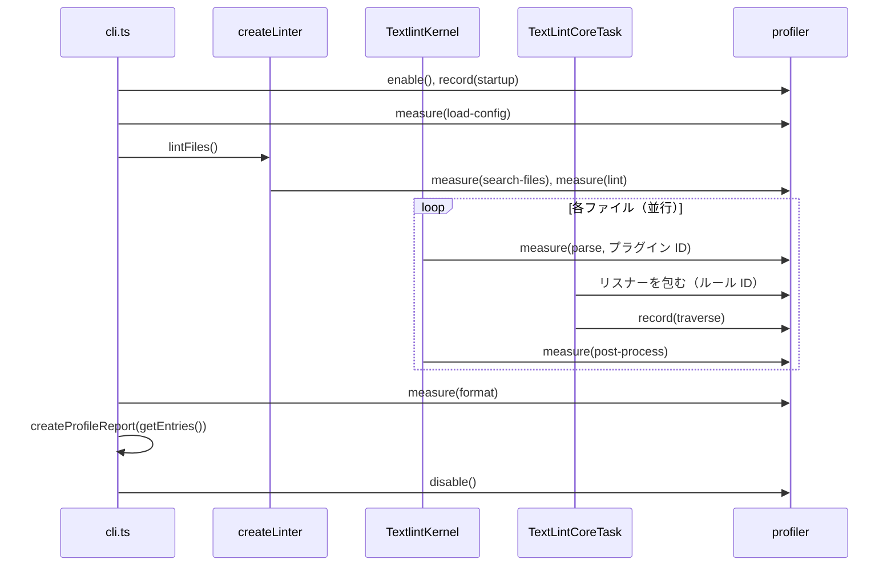

# パフォーマンスプロファイルの設計

[English](design.md)

## この文書について

この文書は [textlint](../../product.ja.md) の [パフォーマンスプロファイル](requirements.ja.md) を設計します。カーネルと CLI が各フェーズ、パーサー、ルール、ファイルの時間をどこで記録するか、ルールの時間をほかのルールの時間からどう分けるか、CLI が要約をどう出力するかを扱います。

### 読者

カーネルや CLI を変更する人とエージェント、プロファイルにフェーズを追加する人とエージェント。

### 前提知識

- カーネルの Lint の流れ：プラグインの `preProcess` がテキストをパースし、`TextLintCoreTask` が木をトラバースして各ノードの種類をルールのリスナーに emit し、`postProcess` とメッセージの処理がメッセージを扱う
- `TIMING=1`：ルールの時間を測り、終了時に表を出力する

### この文書の範囲外

- 2 つのビルドの比較と CPU プロファイル。[変更の比較](../change-comparison/requirements.ja.md) を参照。

## 実装の方針

プロファイラーは `@textlint/kernel` の 1 つのオブジェクト（`src/profile/profiler.ts`）で、`profiler` として export します。カーネルと CLI が同じ集計に記録するためです。
プロファイラーは、種類と ID から集計（回数、合計、最大）への `Map` を持ちます。ファイルパス付きの記録は、そのパスの種類 `file` の集計にも時間を足します。
`enable()` で有効になり、`disable()` で無効になって集計が消えます。

記録する場所はすべて、まず `profiler.enabled` を確かめ、無効なら従来どおりにコードを実行します。そのため `--profile` なしの実行は、ノードごとに時計を読んだり、リスナーを包んだり、クロージャーを確保したりしません。
プロファイラーは `#private` ではなく TypeScript の `private` フィールドを使います。リポジトリのターゲットの ES2018 では、`#private` は `WeakMap` の参照にコンパイルされるためです。

### 何が何を記録するか

| 種類 | ID | 記録する場所 | 測る区間 |
| --- | --- | --- | --- |
| `startup` | - | `cli.executeWithOptions` | CLI が Lint を始めるときの `performance.now()`。プロセスの開始からの時間 |
| `load-config` | - | `cli` | `loadDescriptor()` |
| `search-files` | - | `createLinter` | `lintFiles` と `fixFiles` の `searchFiles()` |
| `lint` / `fix` | - | `createLinter` | `lintFiles` / `fixFiles` のすべてのファイル。STDIN では `lintText` / `fixText` |
| `parse` | プラグイン ID | `TextlintKernel`、`FixerProcessor` | プラグインの `preProcess` |
| `traverse` | - | `TextLintCoreTask.startTraverser` | `traverseController.traverse()` から、その間にすぐ実行またはキューに入れたリスナーの時間を引いたもの |
| `rule` / `filter-rule` | ルール ID | `TextLintCoreTask.tryToAddListenRule` | リスナーの各呼び出し。Promise が終わるまで |
| `post-process` | - | `LinterProcessor`、`FixerProcessor` | `postProcess` とメッセージの処理 |
| `apply-fixes` | - | `FixerProcessor` | `applyFixesToSourceCode()` |
| `format` | - | `cli` | `formatter.format()` |
| `write-files` | - | `cli` | `TextLintFixer.write()` |

`FixerProcessor` は、新しい省略可能なコンストラクター引数としてカーネルからプラグイン ID を受け取ります。修正時のパースの記録も Lint と同じ ID になるようにするためです。

### ルールを分ける

あるノードに対するすべてのルールのリスナーは 1 回の `emit` で呼ばれ、非同期のリスナーはトラバースのあとも続きます。
プロファイルが有効なとき、`tryToAddListenRule` は各リスナーを `profiler.wrapListener()` で包みます。
包んだリスナーは、Promise を待っているリスナーがなければ、呼ばれたときにすぐ実行します。同期のリスナーは、測定しないときと同じ順序とタイミングで実行されます。
リスナーが Promise を返すと、それが終わるまで後続の包んだリスナーはキューで待ちます。記録する時間はリスナーの開始から Promise の終わりまでです。
包んだリスナーの実行中に呼ばれたリスナー（ネストした Lint）は待たずに実行します。外側のリスナーを永遠に待たないためで、その時間は外側のリスナーの時間に含まれます。
包んだリスナーが実行中かどうかは `AsyncLocalStorage` で判断します。`process.getBuiltinModule` で読み込むので、カーネルはブラウザー向けにもバンドルでき、ない場合はキューなしで実行します。

キュー、判定、すぐに実行したリスナーの時間の合計は `src/util/serial-listener-runner.ts` の `createSerialListenerRunner()` が持ち、`TIMING=1` も使います。
両者は 1 つのランナーを共有するので、両方が包んだリスナーもキューでは 1 回だけ実行されます。
リスナー 1 回ごとの記録は、包むときに一度だけ取得した集計オブジェクトに足すので、ノードごとに `Map` を引きません。

`traverse` の時間は、トラバースの実時間から、その間にすぐ実行したリスナーとキューに入れた時間（記録の時間を含む）を引いたものです。つまり、木を歩き、`parent` を設定し、ノードの種類を振り分ける時間で、ルールの処理を含みません。

### CLI

`--profile` は Boolean のオプションです。`cli.executeWithOptions` はプロファイラーを有効にし、`startup` を記録し、`_executeWithOptions` で Lint を実行します。
`finally` で `profiler.getEntries()` からレポートを作り、`Logger.write` で書き、プロファイラーを無効にします。そのため実行が失敗しても要約は出力されます。
`--output-file` がなければ Lint 結果は出力せず、あれば従来どおり書きます。
終了ステータスは `--profile` なしと同じく結果で決まります。

レポートは `textlint` パッケージの `src/profile/profile-report.ts` が作ります。`createProfileReport()` が集計をフェーズ、パーサー、ルール、ファイルにまとめ、`formatProfileReportAsMarkdown()` と `formatProfileReportAsJSON()` が出力します。
合計時間は、レポートを作るときの `performance.now()` です。

## アーキテクチャとシーケンス図



## データモデルと ER 図

```ts
// @textlint/kernel
type TextlintProfileEntry = {
    type: string; // "parse"、"traverse"、"rule"、"filter-rule"、"file"、またはフェーズ
    id: string | undefined; // プラグイン ID、ルール ID、ファイルパス
    count: number;
    total: number; // ミリ秒
    max: number; // ミリ秒
};

// textlint: --profile --format json の JSON
type TextlintProfileReport = {
    total: number;
    files: number;
    phases: { name: string; depth: number; time: number; percent: number; count: number }[];
    parsers: { id: string; time: number; count: number }[];
    rules: { id: string; type: "rule" | "filter-rule"; time: number; percent: number; count: number }[];
    slowestFiles: { filePath: string; time: number }[]; // 最大 10 件、cwd からの相対パス
};
```

フェーズは実行の順に並びます。startup、load-config、search-files、lint または fix、続いて `depth` 1 の parse、traverse、rules、filter-rules、post-process、apply-fixes、最後に format と write-files です。記録のないフェーズは省きます。
`rules` はすべての `rule` の集計の合計で、`count` はリスナーの呼び出し回数です。一度も呼ばれなかったリスナーの集計は `getEntries()` に含めません。

## API とインターフェース

### CLI

```
textlint --profile [--format json] [--output-file <path>] [--fix [--dry-run]] <files...>
textlint --profile --stdin --stdin-filename <name>
```

Markdown は見出し `## textlint profile`、合計時間とファイル数の行、Phases、Parsers、Rules（上位 10 件と、JSON にある残りの件数）、Slowest files のセクションを持ちます。`depth` 1 のフェーズには `↳ ` を付けます。

### `@textlint/kernel`

- `profiler`：共有の `TextlintProfiler`
- `TextlintProfiler`：`enabled`、`enable()`、`disable()`、`record(type, id, milliseconds, filePath?)`、`measure()`、`measureAsync()`、`wrapListener()`、`getEntries()`
- `TextlintProfileEntry`：集計の型

## 外部サービスとの連携

なし。

## データの扱い

集計は `disable()` までメモリーにあります。プロファイラーはファイルに何も書きません。

## 認証と認可の注意

なし。

## セキュリティの考慮事項

Markdown は ID とファイルパスから C0、DEL、C1 の制御文字を取り除き、`\`、`|`、バッククォートをエスケープします。そのためファイル名で表を壊したり端末を制御したりできません。要約は文書のテキストやルールのメッセージを持ちません。

## デプロイの注意

`--profile` は新しいオプションで、`profiler` は `@textlint/kernel` の新しい export です。どちらも追加であり、`--profile` なしでは何も変えません。

## 検討した代替案

### `TIMING=1` を拡張する

`TIMING=1` はルールの時間だけを測り、フォーマッターの出力のあと、終了時に出力します。プロファイルにはフェーズとパーサーと、結果の代わりに出る要約が必要で、環境変数は互換性のために残します。両者は同じランナーを使います。

### 各リスナーの同期部分だけを測る

リスナーの並行性は保てますが、非同期ルールの `await` 以降の処理（トークナイザーを待つルールなど）がルールの時間に数えられません。ルールの時間をすべてそのルールに帰属できるキューを選びました。`TIMING=1` も同じコストを受け入れています。

### すべての呼び出しをキューに入れる

実装は単純ですが、同期のリスナーでも呼び出しごとに Promise を作り、その時間がトラバースに混ざります。Promise を待つリスナーがないときはすぐに実行する方式を選びました。

### プロファイラーを別パッケージにする

集計の大半はカーネルが記録するので、プロファイラーはカーネルに置き、カーネルに依存する CLI はそこから import します。

## 未解決事項

なし。
