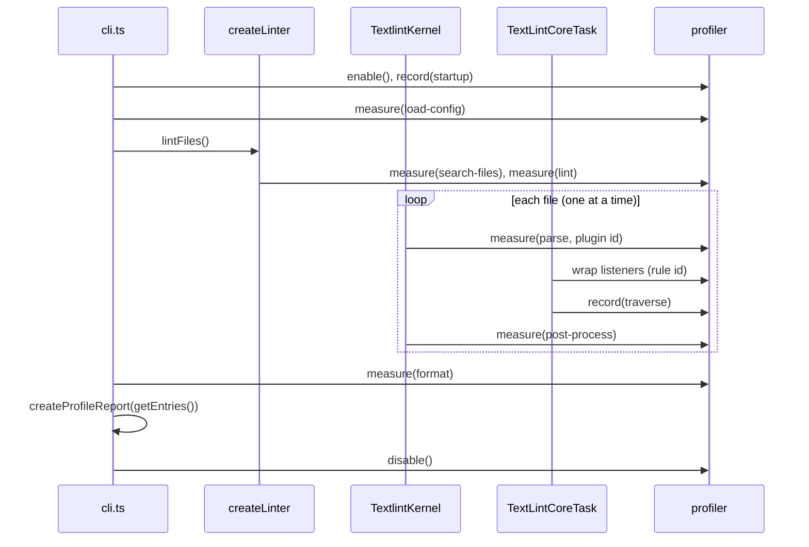

# Performance profile design

[日本語](design.ja.md)

## About this document

This document designs [Performance profile](requirements.md) of [textlint](../../product.md): where the kernel and the CLI record the time of each phase, parser, rule, and file, how the time of a rule is separated from the time of other rules, and how the CLI prints the summary.

### Audience

People and agents who change the kernel or the CLI, or who add a phase to the profile.

### Prerequisites

- The flow of a lint in the kernel: a plugin's `preProcess` parses the text, `TextLintCoreTask` traverses the tree and emits each node type to the listeners of the rules, and `postProcess` and the message processes handle the messages
- `TIMING=1`, which times the rules and prints a table at exit

### Outside this document

- Comparing two builds and the CPU profiles. See [Change comparison](../change-comparison/requirements.md).

## Implementation approach

The profiler is one object in `@textlint/kernel` (`src/profile/profiler.ts`), exported as `profiler`, so that the kernel and the CLI record to the same totals.
It keeps a `Map` from a type and an id to a total (count, sum, and max). A record with a file path also adds the time to the total of type `file` for that path.
`enable()` turns it on, and `disable()` turns it off and clears the totals.

Every place that records checks `profiler.enabled` first and runs the code as before when it is off, so a run without `--profile` does not read the clock, wrap a listener, or allocate a closure for each node.
The profiler uses TypeScript `private` fields instead of `#private`, because `#private` compiles to `WeakMap` lookups for the ES2018 target of the repository.

### What records what

| Type | Id | Recorded by | Measured span |
| --- | --- | --- | --- |
| `startup` | - | `cli.executeWithOptions` | `performance.now()` when the CLI starts to lint, which is the time since the start of the process |
| `load-config` | - | `cli` | `loadDescriptor()` |
| `search-files` | - | `createLinter` | `searchFiles()` of `lintFiles` and `fixFiles` |
| `lint` / `fix` | - | `createLinter` | All files of `lintFiles` / `fixFiles`, or `lintText` / `fixText` for STDIN |
| `parse` | plugin id | `TextlintKernel`, `FixerProcessor` | `preProcess` of the plugin |
| `traverse` | - | `TextLintCoreTask.startTraverser` | `traverseController.traverse()`, without the time of the listeners that ran or were queued during it |
| `rule` / `filter-rule` | rule id | `TextLintCoreTask.tryToAddListenRule` | Each call of a listener, until its Promise settles |
| `post-process` | - | `LinterProcessor`, `FixerProcessor` | `postProcess` and the message processes |
| `apply-fixes` | - | `FixerProcessor` | `applyFixesToSourceCode()` |
| `format` | - | `cli` | `formatter.format()` |
| `write-files` | - | `cli` | `TextLintFixer.write()` |

`FixerProcessor` gets the plugin id from the kernel as a new optional constructor argument, so its parse records have the same id as the lint.

### Separating the rules

The listeners of all rules for a node are called in one `emit`, and an async listener continues after the traversal.
When the profile is on, `tryToAddListenRule` wraps each listener with `profiler.wrapListener()`.
When no wrapped listener is waiting for its Promise, a wrapped listener runs at once when it is called, so synchronous listeners run in the same order and at the same time as without the profile.
When a listener returns a Promise, the following wrapped listeners wait in a queue until it settles. The recorded time is from the start of a listener to the end of its Promise.
A listener that is called while another wrapped listener runs (a nested lint) runs at once, so it does not wait for the outer listener forever; its time is in the time of the outer listener.
`AsyncLocalStorage` tells whether a wrapped listener runs. It is loaded with `process.getBuiltinModule`, so the kernel still bundles for browsers, and without it the listeners run without the queue.

The queue, the detection, and the sum of the time of the listeners that ran at once are `createSerialListenerRunner()` in `src/util/serial-listener-runner.ts`, which `TIMING=1` also uses.
Both share one runner, so a listener that both wrap runs once in the queue.
Each call of a listener adds to total objects that the wrapper looked up once, so a call does not look up the `Map`.

The time of `traverse` is the wall-clock time of the traversal minus the time of the listeners that ran at once or were queued during it, including the time of recording them. So it is the walk over the tree, setting `parent`, and dispatching the node types, without the work of the rules.

### The CLI

`--profile` is a Boolean option. `cli.executeWithOptions` enables the profiler, records `startup`, and runs the lint in `_executeWithOptions`.
In `finally`, it creates the report from `profiler.getEntries()`, writes it with `Logger.write`, and disables the profiler, so the summary is also printed when the run fails.
Without `--output-file`, the lint results are not printed; with it, they are written as before.
The exit status is decided by the results as without `--profile`.

The report is made by `src/profile/profile-report.ts` of the `textlint` package: `createProfileReport()` turns the totals into phases, parsers, rules, and files, and `formatProfileReportAsMarkdown()` and `formatProfileReportAsJSON()` print it.
The total time is `performance.now()` when the report is made.
The number of files is the number of `file` totals, that is, the files that the kernel processed; a file that `--cache` skips has none. With `--stdin`, it is 1.
While profiling, `showEmptyRuleWarning()` writes to the standard error instead of the standard output.

`ExecuteFileBackerManager` of the `textlint` package processes one file at a time while the profiler is enabled.
`measureAsync` measures a phase of a file across `await`; with several files in process, the work of the other files runs in that period and would be counted for the phase.

## Architecture and sequence diagrams



## Data model and ER diagrams

```ts
// @textlint/kernel
type TextlintProfileEntry = {
    type: string; // "parse", "traverse", "rule", "filter-rule", "file", or a phase
    id: string | undefined; // plugin id, rule id, or file path
    count: number;
    total: number; // milliseconds
    max: number; // milliseconds
};

// textlint: the JSON of --profile --format json
type TextlintProfileReport = {
    total: number;
    files: number;
    phases: { name: string; depth: number; time: number; percent: number; count: number }[];
    parsers: { id: string; time: number; count: number }[];
    rules: { id: string; type: "rule" | "filter-rule"; time: number; percent: number; count: number }[];
    slowestFiles: { filePath: string; time: number }[]; // at most 10, relative to cwd
};
```

The phases are in the order of a run: startup, load-config, search-files, lint or fix, then parse, traverse, rules, filter-rules, post-process, and apply-fixes with `depth` 1, then format and write-files. A phase without a record is left out.
`rules` is the sum of all `rule` totals, and `count` is the number of listener calls. `getEntries()` leaves out the totals of listeners that were never called.

## APIs and interfaces

### CLI

```
textlint --profile [--format json] [--output-file <path>] [--fix [--dry-run]] <files...>
textlint --profile --stdin --stdin-filename <name>
```

The Markdown has the heading `## textlint profile`, a line with the total time and the number of files, and the sections Phases, Parsers, Rules (top 10, and how many more are in JSON), and Slowest files. A phase with `depth` 1 has the prefix `↳ `.

### `@textlint/kernel`

- `profiler`: the shared `TextlintProfiler`.
- `TextlintProfiler`: `enabled`, `enable()`, `disable()`, `record(type, id, milliseconds, filePath?)`, `measure()`, `measureAsync()`, `wrapListener()`, `getEntries()`.
- `TextlintProfileEntry`: the type of a total.

## External service integration

None.

## Data handling

The totals live in memory until `disable()`. Nothing is written to a file by the profiler.

## Authentication and authorization notes

None.

## Security considerations

The Markdown removes C0, DEL, and C1 control characters from ids and file paths and escapes `\`, `|`, and backquotes, so a file name can not break the table or control the terminal. The summary has no text of a document and no message of a rule.

## Deployment notes

`--profile` is a new option, and `profiler` is a new export of `@textlint/kernel`. Both are additions and change nothing without `--profile`.

## Alternatives considered

### Extend `TIMING=1`

`TIMING=1` times rules only and prints at exit, after the output of the formatter. The profile needs phases and parsers and a summary that replaces the results, and the environment variable is kept for compatibility. Both use the same runner.

### Measure only the synchronous part of each listener

It would keep the concurrency of the listeners, but the work after an `await` in an async rule, such as a rule that waits for a tokenizer, would not be counted for the rule. The queue was chosen, because it attributes all the time of a rule to it, and `TIMING=1` already accepted the same cost.

### Queue every call

It is simpler, but it creates a Promise for each call of a synchronous listener, and that time would be in the traversal. Running a listener at once when no listener waits for its Promise was chosen.

### A separate package for the profiler

The kernel records most of the totals, so the profiler is in the kernel, and the CLI, which depends on the kernel, imports it from there.

## Open questions

None.
