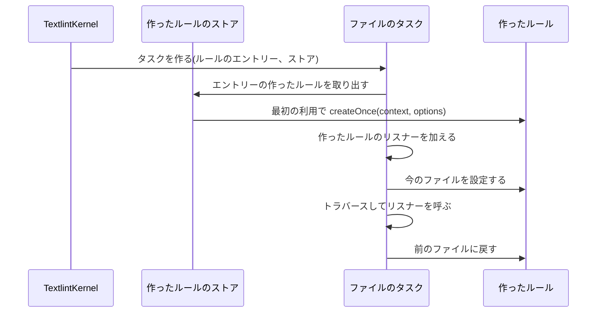

# ルールの 1 回生成の設計

[English](design.md)

## この文書について

この文書は [textlint](../../product.ja.md) の [ルールの 1 回生成](requirements.ja.md) を設計する。`createOnce` が作ったルールをカーネルがどこに持つか、その context が Lint 中のファイルをどう指すか、そのリスナーが各ファイルのトラバースにどう加わるかを扱う。

### 読者

カーネルのタスク、ルールの context、ルールの型を変更する人とエージェント。

### 前提知識

- カーネルの Lint の流れ：`TextlintKernel` はテキストごとにルールのディスクリプターを作り、`LinterProcessor` か `FixerProcessor` がファイルのタスクを作り、タスクがルールのリスナーを登録して TxtAST をトラバースする
- リスナーを包んで計測する [パフォーマンスプロファイル](../performance-profile/requirements.ja.md)

### この文書の範囲外

- ファイルごとに作るフィルタールール

## 実装の方針

1 回作ったルールは 1 つのファイルのタスクより長く生きる必要があり、その context は今のタスクのファイルに報告する必要がある。
そこでカーネルは作ったルールをルールのエントリーのそばに持ち、タスクはトラバースしている間だけ、作ったルールを自分のファイルに向ける。

`TextlintKernel` は作ったルールのストアを持つ。ストアは、呼び出し元が渡したルールのエントリーのオブジェクト(`TextlintKernelRule`)をキーにした `WeakMap` で、Lint 用と修正用を別に持つ。
CLI と `createLinter` はすべてのファイルに同じエントリーのオブジェクトを渡すので、1 回の実行で各ルールは 1 回作られる。新しいエントリーを渡す呼び出し元には新しいルールが作られ、古いルールはエントリーと一緒に回収される。
ストアはモジュールではなくカーネルに属するので、2 つのカーネルがルールを共有することはなく、カーネルより長く残るグローバルなものはない。

タスクはファイルのルールを準備するとき、呼ぶ関数(Lint では `linter`、修正では `fixer`)を確かめる。
その関数が `createOnce` 関数を持つとき、タスクはストアから作ったルールを取り出し(最初の利用で作る)、そのリスナーを自分のエミッターに加える。
持たないときは、これまでどおり context を作ってルール関数を呼ぶ。

### Context と今のファイル

作ったルールは、その生存期間を通して 1 つの context を持つ。
`id`、`severity`、`Syntax`、`RuleError`、`fixer`、`locator` のようにファイルに依存しない値は、ルールを作るときに決まる。
`report`、`getSource`、`getFilePath`、`getConfigBaseDir` は、作ったルールの今のファイル(ソースコード、タスクのレポーター、設定のディレクトリ)を読む。

タスクは、トラバースの直前に各作ったルールの今のファイルを設定し、直後に前のファイルに戻す。リスナーが例外を投げたときも戻す。
消すのではなく戻すことで、ネストした Lint が動く。同じカーネルで別のテキストを Lint するリスナーは、内側のトラバースのために今のファイルを設定し、戻ってきたときには外側のファイルが元に戻っている。
トラバースの外では今のファイルは未設定で、メソッドはルール ID を持つエラーを投げる。`createOnce` の本体でそれらを呼んだときに得るのはこのエラーである。

### 同期的なリスナー

カーネルは多くのファイルを同時に Lint し、作ったルールは 1 つの今のファイルを持つ。
`await` の後に続くリスナーは別のタスクの今のファイルを読んでしまうので、作ったルールのリスナーは同期的でなければならない。
各リスナーはルールを作るときに 1 回だけ包まれ、リスナーが thenable を返すと、ルール ID とノードの種類を持つエラーを投げる。
投げたエラーはトラバースを失敗させ、そのファイルの Lint を失敗させる。

### 計測するリスナー

`TIMING=1` と `--profile` は、各ルールを単独で計測するためにリスナーを包む。
包まれたリスナーは他のルールの非同期のリスナーを待つことがあり、今のファイルが戻された後、トラバースの後に動くことがある。
どちらかが有効なとき、タスクは作ったルールの各リスナーを、呼び出しの前後で今のファイルを設定する関数でファイルごとに包み、その関数を計測のために包む。
ファイルごとの割り当ては計測中だけで、計測はもともとファイルごと、リスナーごとにラッパーを割り当てている。

## アーキテクチャとシーケンス図

## データモデルと ER 図

作ったルールは、その context、ノードの種類と包んだリスナーの組としてのリスナー、今のファイルを持つ。
今のファイルは、ソースコード、タスクのレポーター、設定のディレクトリである。
ストアは、ルールのエントリーから作ったルールへの 2 つの `WeakMap`(Lint 用と修正用)を持つ。
この 3 つのオブジェクトに図は要らない。

## API とインターフェース

### ルール関数の `createOnce`

`@textlint/types` の `TextlintRuleReporter` は、`TextlintRuleCreateOnce` 型の省略できる `createOnce` プロパティを持つ。引数と戻り値はルール関数と同じ。
プロパティを関数に持たせることで、ルールモジュールの形(関数、または `{ linter, fixer }`)を変えない。
`createOnce` のない textlint はプロパティを無視して関数を呼ぶので、`createOnce` に委譲する関数は両方で動く。

### エラー

| 場合 | いつ | メッセージが示すもの |
| --- | --- | --- |
| `createOnce` が例外を投げる | ルールを作るとき | 例外を投げたルール関数と同じくルール ID |
| トラバースの外でファイルのメソッドを呼ぶ | 呼び出し | ルール ID とメソッド |
| リスナーが thenable を返す | トラバース | ルール ID とノードの種類 |

`createOnce` が例外を投げたとき、ストアは何も持たないので、次のファイルでもう一度試す。

## 外部サービスとの連携

なし。カーネルの中の機能である。

## データの扱い

作ったルールは、ファイルのソースコードとレポーターを、そのファイルのトラバースの間だけ持つ。ルール自身の状態はルールが持つ。

## 認証と認可の注意

なし。ルールはこれまでどおりプロセスの権限で動く。

## セキュリティの考慮事項

なし。ルールは利用者がインストールしたコードで、これまでどおり同じプロセスで動く。

## デプロイの注意

なし。

## 検討した代替案

### `before` と `after` のフック

`createOnce` を持つ他のリンターは、ルートのノードやエンジンがファイルごとに必ず呼ばれるリスナーを持たないので、ファイルの前後のフックを持つ。
TxtAST のルートは必ず `Document` なので、そのリスナーが各ファイルの最初と最後に必ず呼ばれる。フックは同じことをする 2 つ目の方法になる。
ファイルを飛ばすフックは別の最適化で、リスナーの使い回しには要らない。

### ファイルごとの context をリスナーに渡す

ファイルの小さな context を各リスナーに渡せば、非同期のリスナーを許せる。
しかしリスナーの引数が変わり、エコシステムのルールやヘルパーが前提にしている「引数は 1 つのノード」が崩れ、ファイルごとの割り当ても戻ってくる。
非同期のルールは少なく、それらはルール関数のままでよい。

### `createOnce` なしで context を共有する

カーネルは、ルールを変えずにルール関数の context をすべてのファイルで使い回せる。
しかしルールはファイルごとにリスナーを作り続け、それがコストの大半であり、非同期のルールが別のファイルに報告しうる。

### モジュールのストア

ルールをキーにしたモジュールレベルのストアは、カーネルをまたいでルールを使い回せるが、カーネルとそのオプションより長く残るグローバルな状態になる。
カーネルのストアで、CLI には同じ使い回しが得られる。
