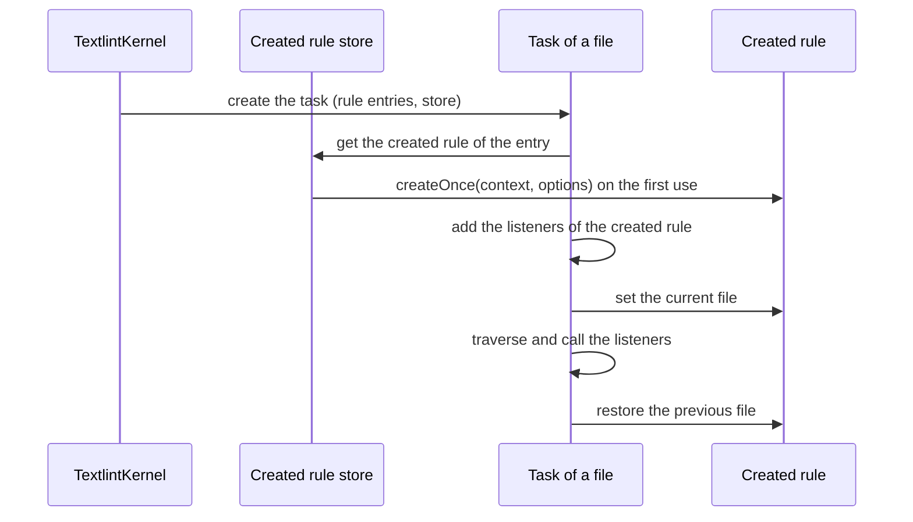

# Rule creation once design

[日本語](design.ja.md)

## About this document

This document designs [Rule creation once](requirements.md) of [textlint](../../product.md): where the kernel keeps a rule that `createOnce` created, how its context refers to the file being linted, and how its listeners join the traversal of each file.

### Audience

People and agents who change the kernel's tasks, the rule context, or the rule types.

### Prerequisites

- The flow of a lint in the kernel: `TextlintKernel` creates a descriptor of the rules for each text, `LinterProcessor` or `FixerProcessor` creates a task for the file, and the task registers the listeners of the rules and traverses the TxtAST
- The [Performance profile](../performance-profile/requirements.md), which wraps listeners to measure them

### Outside this document

- Filter rules, which are created for every file

## Implementation approach

A rule created once has to outlive the task of one file, while its context has to report to the file of the current task.
The kernel therefore keeps the created rule beside the rule entry, and the task points the created rule at its file only while it traverses.

`TextlintKernel` owns a store of created rules. The store keys a created rule by the rule entry object (`TextlintKernelRule`) that the caller passed, in a `WeakMap`, separately for the lint and for the fix.
The CLI and `createLinter` pass the same entry objects for every file, so a run creates each rule once. A caller that passes new entries gets new created rules, and the old ones are collected with their entries.
The store belongs to a kernel and not to the module, so two kernels never share a rule, and nothing global outlives a kernel.

When a task sets up the rules of a file, it checks the function that it would call, `linter` for the lint and `fixer` for the fix.
When the function has a `createOnce` function, the task takes the created rule from the store, creating it on the first use, and adds the listeners of the created rule to its emitter.
Otherwise it creates the context and calls the rule function as before.

### The context and the current file

A created rule has one context for its lifetime.
The values that do not depend on a file, such as `id`, `severity`, `Syntax`, `RuleError`, `fixer`, and `locator`, are fixed when the rule is created.
`report`, `getSource`, `getFilePath`, and `getConfigBaseDir` read the current file of the created rule: the source code, the reporter of the task, and the configuration directory.

The task sets the current file of each created rule just before its traversal and restores the previous one right after it, also when a listener throws.
Restoring instead of clearing keeps a nested lint working: a listener that lints another text with the same kernel sets the current file for the inner traversal, and the outer file is back when it returns.
Outside a traversal the current file is unset, and the methods throw an error with the rule id. This is what `createOnce` gets when it calls them in its body.

### Synchronous listeners

The kernel lints many files at the same time, and a created rule has one current file.
A listener that continues after an `await` would read the current file of another task, so the listeners of a created rule must be synchronous.
Each listener is wrapped once, when the rule is created, by a function that throws an error with the rule id and the node type when the listener returns a thenable.
The thrown error fails the traversal and so the lint of the file.

### Measured listeners

`TIMING=1` and `--profile` wrap listeners so that each rule is measured alone.
A wrapped listener can wait for an asynchronous listener of another rule and run after the traversal, when the current file is already restored.
When either is on, the task wraps each listener of a created rule for its file with a function that sets the current file around the call, and then wraps that function for the measurement.
This allocates for every file only while measuring, which already allocates a wrapper for each listener of each file.

## Architecture and sequence diagrams

## Data model and ER diagrams

A created rule holds its context, its listeners as pairs of a node type and a wrapped listener, and its current file.
The current file is the source code, the reporter of the task, and the configuration directory.
The store holds two `WeakMap`s from a rule entry to a created rule, one for the lint and one for the fix.
A diagram is not needed for these three objects.

## APIs and interfaces

### `createOnce` of a rule function

`TextlintRuleReporter` in `@textlint/types` has an optional `createOnce` property of type `TextlintRuleCreateOnce`, which has the same arguments and return value as the rule function.
Keeping the property on the function keeps the shape of a rule module: a function, or `{ linter, fixer }`.
A textlint without `createOnce` ignores the property and calls the function, so a function that delegates to `createOnce` works on both.

### Errors

| Case | When | Message names |
| --- | --- | --- |
| `createOnce` throws | Creating the rule | The rule id, as for a rule function that throws |
| A file method is called outside a traversal | The call | The rule id and the method |
| A listener returns a thenable | The traversal | The rule id and the node type |

When `createOnce` throws, the store keeps nothing, so the next file tries again.

## External service integration

None. The feature is inside the kernel.

## Data handling

A created rule keeps the source code and the reporter of a file only during the traversal of that file. Its own state is kept by the rule.

## Authentication and authorization notes

None. Rules run with the permissions of the process, as before.

## Security considerations

None. A rule is code that the user installed, and it runs in the same process as before.

## Deployment notes

None.

## Alternatives considered

### `before` and `after` hooks

Other linters with `createOnce` have hooks before and after a file because their root node or their engine does not give a listener that runs for every file.
The root of every TxtAST is `Document`, so its listeners already run first and last for every file. Hooks would be a second way to do the same thing.
A hook that skips a file is a separate optimization and is not needed to reuse the listeners.

### A context for each file passed to the listeners

Passing a small context of the file to each listener would allow asynchronous listeners.
It changes the arguments of listeners, which rules and helpers of the ecosystem assume to be one node, and allocates for every file again.
Asynchronous rules are few, and they keep the rule function.

### Sharing the context without `createOnce`

The kernel could reuse the context of a rule function for every file without any change in rules.
Rules still create their listeners for every file, which is most of the cost, and an asynchronous rule could report to another file.

### A store in the module

A module-level store keyed by the rule would reuse rules across kernels, but it is global state that outlives the kernels and their options.
The store of a kernel gives the same reuse for the CLI.
