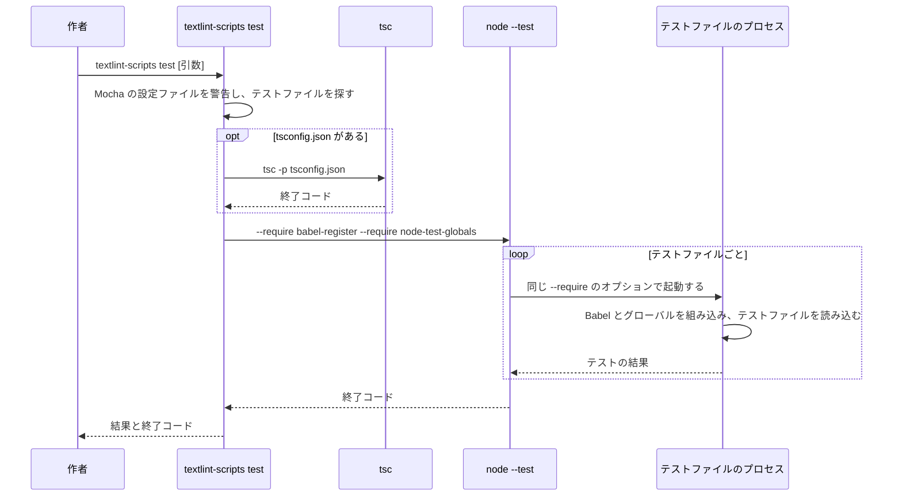

# ルールのテストの設計

[English](design.md)

## この文書について

この設計は、`textlint-scripts` が [textlint の Product](../../product.ja.md) の [ルールのテストの Requirements](requirements.ja.md) をどう満たすかを説明する。

コマンドは、それぞれ 1 つの仕事をする 3 つの部品を組み合わせる。Node.js のテストランナーがテストを実行し、Babel がファイルをトランスパイルし、`tsc` が型をチェックする。
Mocha 向けに書いたテストと Node.js のテストランナーは、グローバルを定義する小さなファイルがつなぐ。

### 読者

`textlint-scripts` や `textlint-tester` を変更する人とエージェント。

### 前提知識

- [Node.js のテストランナー](https://nodejs.org/api/test.html)
- [`@babel/register`](https://babeljs.io/docs/babel-register)

### この文書の範囲外

`textlint-tester` がルールをチェックするしかたと、`textlint-scripts build`。

## 実装の方針

### コマンド

`scripts/test.js` は次の手順を順に実行し、最初に失敗した手順で止まる。

1. **Mocha の設定ファイルについて警告する。** Requirements の Mocha の設定ファイルがあるときは警告を表示する。ファイルは読まない。
2. **テストファイルを探す。** `test/` の下の `.js` ファイルを探し、`tsconfig.json` があるときは `.ts` ファイルも探す。1 つもないときはエラーを表示して終了コード 1 で終わる。Node.js のテストランナーはパターンに何も一致しないときに終了コード 0 で終わるので、コマンドが自分で確かめる。
3. **型をチェックする。** `tsconfig.json` があるときは `tsc -p tsconfig.json` を実行し、失敗したときはその終了コードで終わる。
4. **テストを実行する。** 次の引数で `node` を起動し、そのプロセスの終了コードで終わる。

```
node --require configs/babel-register.js
     --require configs/node-test-globals.js
     --test --test-timeout=10000 --test-reporter=spec
     <作者の引数> <テストファイルのパターン>
```

テストランナーはテストファイルごとにプロセスを起動し、そのプロセスに `--require` のオプションを渡す。そのため、各プロセスは自分のファイルをトランスパイルし、グローバルを持つ。
`--test-timeout` と `--test-reporter` は、作者が指定しなかったときだけ加える。
Node.js は最初のファイルパスより前にあるオプションだけを読むので、作者の引数はパターンより前に置く。

コマンドはシェルを使わずにプロセスを起動する。そのため、空白を含むパスや引用符を含む引数はそのまま渡る。

### トランスパイル

`configs/babel-register.js` は、`textlint-scripts build` も使う `configs/babel.config.js` のプリセットとプラグインで `@babel/register` を呼ぶ。
Babel は `import` と `export` を CommonJS に変換するので、各ファイルは `require` で読み込まれる。
これにより、ファイルの拡張子がない `import`、`__dirname`、`require` が動き続ける。`require` は拡張子のないパスを解決し、CommonJS は `__dirname` を定義するからである。
Babel は TypeScript の型をチェックせずに取り除くので、型チェックは手順 3 の `tsc` に任せる。

`register.js` と `register-ts.js` はどちらも `configs/babel-register.js` を require する。
Node.js のモジュールキャッシュによって、1 つのプロセスではこのファイルは 1 回だけ読み込まれる。そのため、両方のスクリプトを読み込んでも組み込まれるトランスパイルは 1 つである。

### グローバル

`configs/node-test-globals.js` は、Requirements のグローバルを `node:test` の関数で定義する。
グローバルは定義されていないときだけ設定する。そのため、先に読み込まれたテストランナーは自分のグローバルを保つ。
`Symbol.for` で作ったシンボルがグローバルを組み込んだことを示す。そのため、`textlint-scripts` が 2 つ読み込まれても、グローバルは 1 回だけ組み込まれる。

各グローバルは、`node:test` の同じ目的の関数を包む。

| グローバル | `node:test` の関数 | 包み方 |
| --- | --- | --- |
| `describe`、`context` | `describe` | スイートの関数を Mocha 形式の `this` で呼び、関数が投げたエラーを失敗するテストにする |
| `it`、`specify` | `it` | テスト関数を変換する |
| `before`、`after`、`beforeEach`、`afterEach` | 同じ名前 | 最初の引数に渡された名前を捨て、フック関数を変換する |

テスト関数やフック関数の変換は、その引数の数で決まる。

- **引数なし：** 関数を Mocha 形式の `this` で呼び、結果を待つ。
- **引数が 1 つ以上：** 関数はコールバック形式である。包む関数は引数を 2 つ宣言し、`node:test` にコールバックを待つよう伝える。そして、そのコールバックを `done` として関数に渡す。

Mocha 形式の `this` は、`this` を返して何もしない `timeout()` と `slow()`、テストコンテキストの `skip()` を呼んで印を付けたエラーを投げて関数を止める `skip()` を持つ。包む関数は、印の付いたエラーをスキップしたテストの終わりとして扱う。

スイートの関数は、`node:test` がスイートを組み立てる間に実行される。この関数が例外を投げると、`node:test` はスイートを失敗として報告するが、Node.js のバージョンによっては終了コード 0 で終わる。包む関数はエラーを捕まえ、そのエラーを投げるテストをスイートに定義する。そのため、失敗は失敗したテストとして数えられ、プロセスは終了コード 1 で終わる。

### `textlint-tester`

`textlint-tester` は、読み込まれたときに `globalThis.describe` と `globalThis.it` を調べ、それを使ってルールごとのスイートとケースごとのテストを定義する。
グローバルはどのテストファイルよりも前に `--require` で組み込まれるので、`textlint-tester` は `node:test` でテストを定義する。

## アーキテクチャとシーケンス図



## データモデルと ER 図

なし。コマンドはデータを保持しない。

## API とインターフェース

### コマンド

`textlint-scripts test [引数]` は、引数を `node --test` に渡す。
終了コードは、型チェックが失敗したときは `tsc` のもの、テストファイルがないときは 1、それ以外は `node --test` のものである。

### register スクリプト

`textlint-scripts/register` と `textlint-scripts/register-ts` は、export を持たない CommonJS のファイルで、`--require` で読み込む。

### パッケージの依存

`textlint-scripts` は、Babel のパッケージ、`cross-spawn`、`textlint-tester` に依存する。
`typescript` は `tsc` のために使う、省略可能な peer dependency である。
テストフレームワークにも、ts-node のような TypeScript のランタイムにも依存しない。

## 外部サービスとの連携

なし。

## データの扱い

なし。

## 認証と認可の注意

なし。

## セキュリティの考慮事項

コマンドは作者の引数をシェルを使わずに `node` に渡すので、引数がシェルに解釈されることはない。
テストファイルは、他のテストランナーと同じく作者の権限で実行される。

## デプロイの注意

テスト関数、トランスパイル、引数を変えると既存のテストが失敗することがあるので、そのような変更はメジャーバージョンでだけリリースする。
リリースノートには、Mocha の設定ファイルから引数へ移すオプションなど、作者が変える必要のあることを挙げる。

## 検討した代替案

### Node.js の型の除去で TypeScript を実行する

Node.js は型を取り除いて TypeScript を実行できるので、`textlint-scripts test` から Babel をなくせる。
採用しなかったのは、この方法で読み込んだファイルは `import` を使うと ES モジュールになるからである。
ES モジュールはファイルの拡張子がない相対パスを解決せず、`__dirname` も持たないが、ほとんどのルールパッケージはこの両方を使っている。
また、`textlint-tester` は default export が `exports.default` の CommonJS モジュールなので、ES モジュールはクラスではなくオブジェクトを受け取る。
これらはほとんどのルールパッケージの変更を必要とし、Requirements はそれを認めていない。

### 型の除去に resolve フックを加える

`module.registerHooks()` で登録する resolve フックは、足りないファイルの拡張子を補える。
採用しなかったのは、直るのが拡張子だけだからである。`__dirname`、`import type` を使わない型の import、`import` と `module.exports` を混ぜたファイル、`textlint-tester` の default export は失敗したままになる。

### Mocha を使い続ける

Mocha は、グローバル、`done` コールバック、設定ファイルをすでに提供している。
採用しなかったのは、すべてのルールパッケージにとってテストフレームワークの依存になり、さらに Mocha の `--require` が作者の register スクリプトとコマンドのものをまとめるので、1 つのファイルが 2 回トランスパイルされる原因になっていたからである。

### Vitest など別のテストランナーを使う

Vitest は Mocha 形式のグローバルを提供し、TypeScript をトランスパイルする。
採用しなかったのは、Node.js のテストランナーとグローバルを定義する小さなファイルに比べて、ずっと大きな依存になるからである。

### ts-node や tsx など TypeScript のランタイムを使う

ts-node はトランスパイルしながら型をチェックするので、別のトランスパイラーがすでにファイルを変えていると失敗する。
tsx は型をチェックしないが、`textlint-scripts build` がすでに必要とする Babel に加えて、もう 1 つの依存になる。
Babel が `textlint-scripts build` のために同じファイルをすでにトランスパイルしているので、どちらも採用しなかった。

## 未解決事項

なし。[Requirements の未解決事項](requirements.ja.md#未解決事項) は、決まるまでこの設計を変えない。
