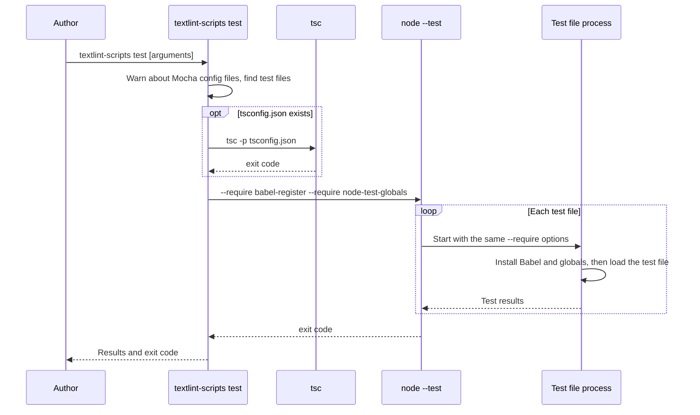

# Rule testing design

[日本語](design.ja.md)

## About this document

This design explains how `textlint-scripts` meets the [Rule testing Requirements](requirements.md) of the [textlint Product](../../product.md).

The command combines three parts that each do one job: the test runner of Node.js runs the tests, Babel transpiles the files, and `tsc` type-checks them.
A small file of globals connects tests written for Mocha to the test runner of Node.js.

### Audience

People and agents who change `textlint-scripts` or `textlint-tester`.

### Prerequisites

- [Test runner of Node.js](https://nodejs.org/api/test.html)
- [`@babel/register`](https://babeljs.io/docs/babel-register)

### Outside this document

How `textlint-tester` checks a rule, and `textlint-scripts build`.

## Implementation approach

### Command

`scripts/test.js` runs these steps in order and stops at the first that fails.

1. **Warn about Mocha config files.** When a Mocha config file of the Requirements exists, it prints a warning. It does not read the file.
2. **Find test files.** It looks for `.js` files under `test/`, and also `.ts` files when `tsconfig.json` exists. When there is none, it prints an error and exits with code 1. The test runner of Node.js exits with code 0 when a pattern matches nothing, so the command checks this itself.
3. **Type-check.** When `tsconfig.json` exists, it runs `tsc -p tsconfig.json`, and exits with its code when it fails.
4. **Run the tests.** It starts `node` with the arguments below and exits with the code of that process.

```
node --require configs/babel-register.js
     --require configs/node-test-globals.js
     --test --test-timeout=10000 --test-reporter=spec
     <arguments of the author> <test file pattern>
```

The test runner starts a process for each test file and passes the `--require` options to it, so each process transpiles its files and has the globals.
`--test-timeout` and `--test-reporter` are added only when the author does not give them.
The arguments of the author come before the pattern, because Node.js reads options only before the first file path.

The command starts processes without a shell, so a path with spaces or a quote in an argument is passed as it is.

### Transpilation

`configs/babel-register.js` calls `@babel/register` with the presets and plugins of `configs/babel.config.js`, which `textlint-scripts build` uses too.
Babel converts `import` and `export` into CommonJS, so each file is loaded by `require`.
This is what keeps an `import` without a file extension, `__dirname`, and `require` working: `require` resolves a path without an extension, and CommonJS defines `__dirname`.
Babel removes TypeScript types without checking them, so type checking is left to `tsc` in step 3.

`register.js` and `register-ts.js` both require `configs/babel-register.js`.
The module cache of Node.js loads it once in a process, so loading both scripts installs one transpilation.

### Globals

`configs/node-test-globals.js` defines the globals of the Requirements with functions of `node:test`.
It sets a global only when it is not defined, so a test runner loaded before it keeps its own globals.
A symbol from `Symbol.for` marks that the globals are installed, so the file installs them once even when two copies of `textlint-scripts` are loaded.

Each global wraps the function of the same purpose in `node:test`:

| Global | `node:test` function | Wrapping |
| --- | --- | --- |
| `describe`, `context` | `describe` | Calls the suite function with a Mocha-style `this`, and turns an error that it throws into a failing test |
| `it`, `specify` | `it` | Converts the test function |
| `before`, `after`, `beforeEach`, `afterEach` | Same name | Drops a name given as the first argument and converts the hook function |

The conversion of a test or hook function depends on its number of parameters.

- **No parameter:** The function is called with a Mocha-style `this`, and its result is awaited.
- **One or more parameters:** The function is callback style. The wrapper declares two parameters, which tells `node:test` to wait for its callback, and passes the callback to the function as `done`.

The Mocha-style `this` has `timeout()` and `slow()`, which return `this` and do nothing, and `skip()`, which calls `skip()` of the test context and throws a marked error to stop the function. The wrapper treats the marked error as the end of a skipped test.

A suite function runs while `node:test` builds the suite. When it throws, `node:test` reports the suite as failed, but some versions of Node.js still exit with code 0. The wrapper catches the error and defines a test in the suite that throws it, so the failure is counted as a failing test and the process exits with code 1.

### `textlint-tester`

`textlint-tester` checks `globalThis.describe` and `globalThis.it` when it is loaded, and uses them to define a suite for each rule and a test for each case.
Because the globals are installed by `--require` before any test file is loaded, `textlint-tester` defines its tests with `node:test`.

## Architecture and sequence diagrams



## Data model and ER diagrams

None. The command keeps no data.

## APIs and interfaces

### Command

`textlint-scripts test [arguments]` passes the arguments to `node --test`.
The exit code is that of `tsc` when the type check fails, 1 when there is no test file, and that of `node --test` otherwise.

### Register scripts

`textlint-scripts/register` and `textlint-scripts/register-ts` are CommonJS files without exports, loaded with `--require`.

### Package dependencies

`textlint-scripts` depends on the Babel packages, `cross-spawn`, and `textlint-tester`.
`typescript` is an optional peer dependency, used for `tsc`.
It depends on no test framework and no TypeScript runtime such as ts-node.

## External service integration

None.

## Data handling

None.

## Authentication and authorization notes

None.

## Security considerations

The command passes the arguments of the author to `node` without a shell, so an argument is not interpreted by a shell.
The test files run with the permissions of the author, as with any test runner.

## Deployment notes

A change to the test functions, the transpilation, or the arguments can make an existing test fail, so such a change is released only in a major version.
The release notes list what an author has to change, such as options moved from a Mocha config file to arguments.

## Alternatives considered

### Run TypeScript with the type stripping of Node.js

Node.js can run TypeScript by removing types, which would remove Babel from `textlint-scripts test`.
It was not chosen because a file loaded this way is an ES module when it uses `import`.
An ES module does not resolve a relative path without a file extension and has no `__dirname`, and most rule packages use both.
`textlint-tester` is also a CommonJS module whose default export is `exports.default`, which an ES module receives as an object, not as the class.
These would require a change to most rule packages, which the Requirements rule out.

### Add a resolve hook to the type stripping

A resolve hook registered with `module.registerHooks()` can add the missing file extension.
It was not chosen because it fixes only the extension. `__dirname`, type imports without `import type`, files that mix `import` with `module.exports`, and the default export of `textlint-tester` would still fail.

### Keep Mocha

Mocha already provides the globals, the `done` callback, and config files.
It was not chosen because it is a test framework dependency of every rule package, and its `--require` merges the register scripts of the author with those of the command, which caused one file to be transpiled twice.

### Use another test runner, such as Vitest

Vitest provides Mocha-style globals and transpiles TypeScript.
It was not chosen because it is a much larger dependency than the test runner of Node.js and the small file of globals.

### Use a TypeScript runtime, such as ts-node or tsx

ts-node type-checks while it transpiles, so it fails when another transpiler has already changed the file.
tsx does not type-check, but it is an extra dependency next to Babel, which `textlint-scripts build` already needs.
Neither was chosen, because Babel already transpiles the same files for `textlint-scripts build`.

## Open questions

None. The open questions of the [Requirements](requirements.md#open-questions) do not change this design until they are decided.
