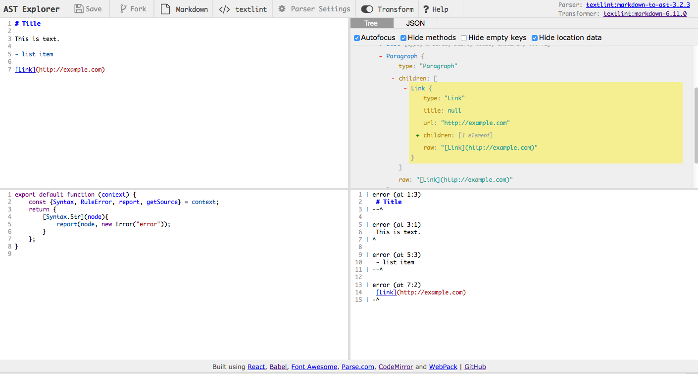

TxtAST define AST(Abstract Syntax Tree) for processing in textlint.

## What is AST?

[Abstract syntax tree](https://en.wikipedia.org/wiki/Abstract_syntax_tree "Abstract syntax tree - Wikipedia, the free encyclopedia") is a tree representation of the abstract syntactic structure of text.

textlint's plugin parse text to AST. AST is a tree structure that is consist of `Txt{{Type}}Node` like `TxtParagraphNode`.
Each node has common properties like `type`, `raw`, `loc`, `range` and `parent` that is defined in `TxtNode` interface.

Each node has own properties that is defined in each node type.

[](https://textlint.org/astexplorer/)

[AST explorer for textlint](https://textlint.org/astexplorer/ "AST explorer for textlint") is useful for understanding AST.

### `TxtNode`

`TxtNode` is an abstract node.

```typescript
/**
 * Basic TxtNode
 * Probably, Real TxtNode implementation has more properties.
 */
interface TxtNode {
    readonly type: string;
    readonly raw: string;
    readonly range: TxtNodeRange;
    readonly loc: TxtNodeLocation;
    // parent is runtime information
    // Not need in AST
    // For example, top Root Node like `Document` has not parent.
    readonly parent?: TxtNode;
}


/**
 * Location
 */
interface TxtNodeLocation {
    readonly start: TxtNodePosition;
    readonly end: TxtNodePosition;
}

/**
 * Position's line start with 1.
 * Position's column start with 0.
 * This is for compatibility with JavaScript AST.
 * https://gist.github.com/azu/8866b2cb9b7a933e01fe
 */
interface TxtNodePosition {
    readonly line: number; // start with 1
    readonly column: number; // start with 0
}

/**
 * Range start with 0
 */
export type TxtNodeRange = readonly [startIndex: number, endIndex: number];
```

`TxtNode` **must** have these properties.

- `type`: type of Node
- `raw`: source text of Node. It is the text of `range`
    - if you want to get raw value, please use `getSource(<node>)` instead of it..
- `loc`: location object. `start` and `end` are the positions of `range[0]` and `range[1]`
- `range`: location info array like `[startIndex, endIndex]`. `endIndex` is exclusive
- `parent`: (optional) parent node of this node.
    - It is attached in runtime
    - Parser user ignore this property

These properties are readonly in TypeScript.
Rules should read the AST and report issues or fixes through the rule APIs instead of mutating nodes directly.

### `TxtTextNode`

`TxtTextNode` is an abstract node that inherit `TxtNode` interface.

```typescript
/**
 * Text Node.
 * Text Node has inline value.
 * For example, `Str` Node is a TxtTextNode.
 */
interface TxtTextNode extends TxtNode {
    readonly value: string;
}
```

`TxtTextNode` **must** have these properties.

- `value`: the content of the node without the markup. It may differ from `raw`.

Example: `Str` node is a `TxtTextNode`.

### `TxtParentNode`

`TxtParentNode` is an abstract node that inherit `TxtNode` interface.

```typescript
/**
 * Parent Node.
 * Parent Node has children that are consist of TxtNode or TxtTextNode
 */
interface TxtParentNode extends TxtNode {
    readonly children: readonly (TxtNode | TxtTextNode)[];
}
```

`TxtParentNode` **must** have these properties.

- `children`: child nodes of this node.

Example: `Paragraph` node is a `TxtParentNode`.

### `type`

`type` is TxtNode type.

All Types are defined in `@textlint/ast-node-types`.
You can use this `ASTNodeTypes` value via following way:

```js
import { ASTNodeTypes } from "@textlint/ast-node-types";

console.log(ASTNodeTypes.Str); // "Str"
```

You can get Node type for Type name by `TypeofTxtNode` in TypeScript.

```ts
// In TypeScript
import { ASTNodeTypes } from "@textlint/ast-node-types";

import type { TypeofTxtNode } from "@textlint/ast-node-types";

type NodeType = TypeofTxtNode<ASTNodeTypes.Str>; // TxtStrNode
```

### All node types

These types are defined in [`@textlint/ast-node-types`](https://github.com/textlint/textlint/tree/master/packages/%40textlint/ast-node-types).
They are shared by all formats, and their names are PascalCase.

Block nodes:

| Type name                   | Node type                           | Description                                 |
|-----------------------------|-------------------------------------|---------------------------------------------|
| ASTNodeTypes.Document       | TxtDocumentNode(TxtParentNode)      | Root Node                                   |
| ASTNodeTypes.Paragraph      | TxtParagraphNode(TxtParentNode)     | Paragraph Node                              |
| ASTNodeTypes.Header         | TxtHeaderNode(TxtParentNode)        | # Header Node                               |
| ASTNodeTypes.BlockQuote     | TxtBlockQuoteNode(TxtParentNode)    | > Block Quote Node                          |
| ASTNodeTypes.List           | TxtListNode(TxtParentNode)          | List Node                                   |
| ASTNodeTypes.ListItem       | TxtListItemNode(TxtParentNode)      | List (each) item Node                       |
| ASTNodeTypes.CodeBlock      | TxtCodeBlockNode(TxtTextNode)       | Code Block Node                             |
| ASTNodeTypes.HorizontalRule | TxtHorizontalRuleNode               | Horizontal Node(`---`)                      |
| ASTNodeTypes.Html           | TxtHtmlNode(TxtTextNode)            | HTML Node, as a block or inline             |
| ASTNodeTypes.Comment        | TxtCommentNode(TxtTextNode)         | Comment Node                                |
| ASTNodeTypes.Table          | TxtTableNode(TxtParentNode)         | Table Node. textlint 13+                    |
| ASTNodeTypes.TableRow       | TxtTableRowNode(TxtParentNode)      | Table row Node. textlint 13+                |
| ASTNodeTypes.TableCell      | TxtTableCellNode(TxtParentNode)     | Table cell Node. textlint 13+               |
| ASTNodeTypes.Definition     | TxtDefinitionNode                   | Definition Node(`[1]: https://example.com`) |

Inline nodes:

| Type name                   | Node type                           | Description                                 |
|-----------------------------|-------------------------------------|---------------------------------------------|
| ASTNodeTypes.Str            | TxtStrNode(TxtTextNode)             | Str Node. The text that rules check         |
| ASTNodeTypes.Break          | TxtBreakNode                        | Hard Break Node(`Str<space><space>`)        |
| ASTNodeTypes.Emphasis       | TxtEmphasisNode(TxtParentNode)      | Emphasis(`*Str*`)                           |
| ASTNodeTypes.Strong         | TxtStrongNode(TxtParentNode)        | Strong Node(`**Str**`)                      |
| ASTNodeTypes.Delete         | TxtDeleteNode(TxtParentNode)        | Delete Node(`~Str~`)                        |
| ASTNodeTypes.Code           | TxtCodeNode(TxtTextNode)            | Inline Code Node                            |
| ASTNodeTypes.Link           | TxtLinkNode(TxtParentNode)          | Link Node                                   |
| ASTNodeTypes.Image          | TxtImageNode                        | Image Node                                  |
| ASTNodeTypes.LinkReference  | TxtLinkReferenceNode(TxtParentNode) | Link Reference Node(`[link][1]`)            |
| ASTNodeTypes.ImageReference | TxtImageReferenceNode               | Image Reference Node(`![alt][1]`)           |

> 📝Note
> `LinkReference`, `ImageReference` and `Definition` are introduced in textlint [v14.5.0](https://github.com/textlint/textlint/releases/tag/v14.5.0).

Each type has an exit type, such as `ASTNodeTypes.ParagraphExit` (`"Paragraph:exit"`).
A rule uses the exit type to handle a node after its children. The node is the same.

#### Deprecated names

These names remain in `ASTNodeTypes` for compatibility, but parsers do not produce them.

| Deprecated name           | Use instead             |
|---------------------------|-------------------------|
| ASTNodeTypes.HtmlBlock    | ASTNodeTypes.Html       |
| ASTNodeTypes.ReferenceDef | ASTNodeTypes.Definition |

Some node have additional properties.
For example, `TxtHeaderNode` has `depth` property.

```ts
export interface TxtHeaderNode extends TxtParentNode {
    readonly type: "Header";
    readonly depth: 1 | 2 | 3 | 4 | 5 | 6;
    readonly children: readonly PhrasingContent[];
}
```

For more details, see [`@textlint/ast-node-types`](https://github.com/textlint/textlint/tree/master/packages/%40textlint/ast-node-types).

- [`@textlint/ast-node-types/src/NodeType.ts`](https://github.com/textlint/textlint/tree/master/packages/%40textlint/ast-node-types/src/NodeType.ts).

These type are based on HTML tag and Markdown syntax.

### Node types of a format

A format can add its own node types for structures that the types above do not cover.
The name of such a node type starts with a lowercase letter, so you can tell from the name whether a node type is shared by all formats.
For example, the Markdown parser produces `yaml` for front matter and `footnoteReference` for a footnote reference.

These node types are not defined in `@textlint/ast-node-types`, but a rule can specify them as just a string.

```js
// A rule can treat "yaml" node type
export default () => {
    return {
        ["yaml"](node) {
            // do something
        }
    };
};
```

### Minimal node property

TxtAST allow to extend node property.
The type definitions of `@textlint/ast-node-types` define the properties of each node type.
A property that is optional in the type definitions may be absent, `undefined`, or `null`.
Every other property is required. The following nodes have required properties.

#### `Header`

- `depth`: level of header
    - Example: `<h1>` is `depth:1`, `<h2>` is `depth:2`...

#### `Link`

- `url`: link url

#### `Image`

- `url`: image url

#### `Definition`

- `identifier`: normalized form of `label`. A reference and its definition have the same `identifier`
- `label`: label as written in the document
- `url`: url of the definition

#### `LinkReference` and `ImageReference`

- `identifier` and `label`: same as `Definition`
- `referenceType`: `"full"`, `"collapsed"`, or `"shortcut"`

## Built-in Parser

textlint has built-in parsers.

| Package                                                                                                            | Version                                                                                                                                         | Description       |
|--------------------------------------------------------------------------------------------------------------------|-------------------------------------------------------------------------------------------------------------------------------------------------|-------------------|
| [`@textlint/markdown-to-ast`](https://github.com/textlint/textlint/tree/master/packages/@textlint/markdown-to-ast) | [](https://www.npmjs.com/package/@textlint/markdown-to-ast) | markdown parser   |
| [`@textlint/text-to-ast`](https://github.com/textlint/textlint/tree/master/packages/@textlint/text-to-ast)         | [](https://www.npmjs.com/package/@textlint/text-to-ast)         | plain text parser |

If you want to get other type, please [create new issue](https://github.com/textlint/textlint/issues/new).

## Package

That `TxtNode` interface is defined in [packages/ast-node-types](https://github.com/textlint/textlint/tree/master/packages/@textlint/ast-node-types).

If you want to use this interface from TypeScript, [packages/ast-node-types](https://github.com/textlint/textlint/tree/master/packages/@textlint/ast-node-types) is useful.

## Online Parsing Demo

[](https://textlint.org/astexplorer/)

[AST explorer for textlint](https://textlint.org/astexplorer/ "AST explorer for textlint") is useful for understanding AST.

Minimum(recommended) rules is following code:

```js
/**
 * @param {RuleContext} context
 */
export default function(context) {
    const { Syntax } = context;
    // root object
    return {
        [Syntax.Document](node) {
        },
        [Syntax.Paragraph](node) {
        },
        [Syntax.Str](node) {
        }
    };
}
```

### `loc`

`loc` is location info object.

```json
{
  "loc": {
    "start": {
      "line": 2,
      "column": 4
    },
    "end": {
      "line": 2,
      "column": 10
    }
  }
}
```

- `line` of location start with 1 (1-indexed).
- `column` of location start with 0 (**0-indexed**).

This is for compatibility with JavaScript AST.

- [Why do `line` of location in JavaScript AST(ESTree) start with 1 and not 0?](https://gist.github.com/azu/8866b2cb9b7a933e01fe "Why do `line` of location in JavaScript AST(ESTree) start with 1 and not 0?")

`loc` and `range` describe the same span.

- `raw` is the text from `range[0]` to `range[1]`.
- `loc.start` is the line and column of `range[0]`, and `loc.end` is the line and column of `range[1]`.
- The character after a line ending is at column 0 of the next line. If a node ends right after a line ending, `loc.end` is on the next line.
- The `range` of a child is inside the `range` of its parent, and siblings do not overlap.

**Important Note:**

> Text -> AST TxtNode(**0-based columns** here) -> textlint -> TextLintMessage(1-based columns)

`TxtNode` has **0-based columns**, but the result of linting named `TextLintMessage` has **1-based columns**.

In other word, textlint's rule handle `TxtNode`, but [formatter](./formatter.md "Formatter") handle `TextLintMessage`.

## Example

Input: `*text*`

Output: The AST by [AST explorer for textlint](https://textlint.org/astexplorer/ "AST explorer for textlint") + Markdown

```json
{
  "type": "Document",
  "children": [
    {
      "type": "Paragraph",
      "children": [
        {
          "type": "Emphasis",
          "children": [
            {
              "type": "Str",
              "value": "text",
              "loc": {
                "start": {
                  "line": 1,
                  "column": 1
                },
                "end": {
                  "line": 1,
                  "column": 5
                }
              },
              "range": [
                1,
                5
              ],
              "raw": "text"
            }
          ],
          "loc": {
            "start": {
              "line": 1,
              "column": 0
            },
            "end": {
              "line": 1,
              "column": 6
            }
          },
          "range": [
            0,
            6
          ],
          "raw": "*text*"
        }
      ],
      "loc": {
        "start": {
          "line": 1,
          "column": 0
        },
        "end": {
          "line": 1,
          "column": 6
        }
      },
      "range": [
        0,
        6
      ],
      "raw": "*text*"
    }
  ],
  "loc": {
    "start": {
      "line": 1,
      "column": 0
    },
    "end": {
      "line": 1,
      "column": 6
    }
  },
  "range": [
    0,
    6
  ],
  "raw": "*text*"
}
```

Illustration

```
          *   text   *
          |   |__|   |
          |   value  |
          |__________|
               raw
```

- Document is a `TxtParentNode` and type is Document
    - have `children`, but not have `value`
- Paragraph is a `TxtParentNode` and type is Paragraph
    - have `children`, but not have `value`
- *Emphasis* is a `TxtParentNode` and type is Emphasis
    - have `children`, but not have `value`
- "text" is a `TxtTextNode` and type is Str
    - have `value`

## Unist

`TxtAST` have a minimum of compatibility for [unist: Universal Syntax Tree](https://github.com/syntax-tree/unist "wooorm/unist: Universal Syntax Tree").

We have discussed Unist in [Compliances tests for TxtNode #141](https://github.com/textlint/textlint/issues/141 "Compliances tests for TxtNode #141").

## For testing Processor plugin

You can use [@textlint/ast-tester](https://github.com/textlint/textlint/tree/master/packages/@textlint/ast-tester "@textlint/ast-tester") for testing your processor plugin's parser.

- [textlint/@textlint/ast-tester: Compliance tests for textlint's AST](https://github.com/textlint/textlint/tree/master/packages/@textlint/ast-tester)

```js
import { test, isTxtAST } from "@textlint/ast-tester";
// your implement
import yourParse from "your-parser";
// recommenced: test much pattern test
const AST = yourParse("This is text");

// Validate AST
test(AST); // if the AST is invalid, then throw Error

isTxtAST(AST); // true or false
```

:warning: Current `test` function does not check node specific properties.
For example, `TxtHeaderNode` has `depth` property, but `test` function does not check it.

- Issue: [ast-tester should validate individual Node type · Issue #1009 · textlint/textlint](https://github.com/textlint/textlint/issues/1009)
